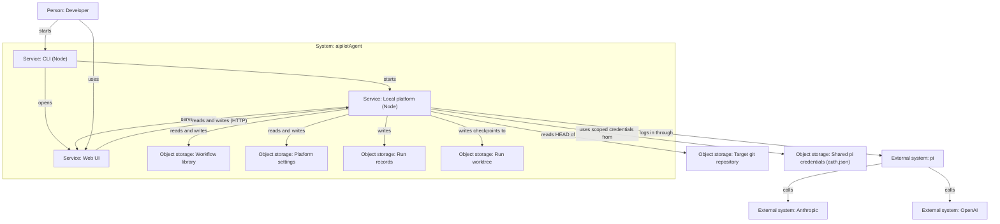
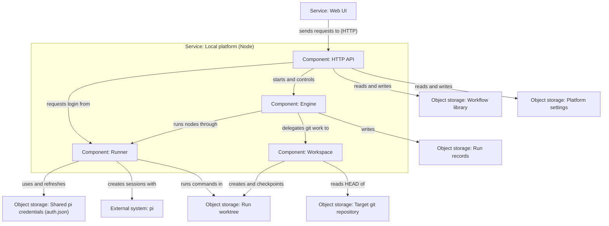

# Architecture

## Summary

aipilotAgent 是本机单用户工作流平台。
平台由 runner、engine 和 service 三个包组成。
本文件按已确认的规格和决策描述 v1 结构。
用户在浏览器中搭建工作流。
用户把工作流跑在目标 git 仓库上。
平台包括 CLI、本地服务和 Web UI。
引擎和 runner 都在本地服务里。
节点只通过产物文件和 git 工作区交接。
pi 执行 agent 节点。
节点可使用 Anthropic 或 OpenAI 的模型。

## Container View

开发者用 CLI 启动本机平台。
CLI 打开浏览器中的 Web UI。
本地服务向浏览器提供页面。
Web UI 读写工作流库和设置。
Web UI 通过本机 HTTP 让本地服务开始一次运行。
本地服务从目标仓库的 HEAD 建立独立工作区。
agent 节点由 pi 调用各家模型。
命令节点在工作区中执行。
运行记录不写入目标仓库。

## Component View: Local platform

HTTP API 是界面的唯一入口。
引擎调度节点。
引擎拥有运行记录。
Workspace 负责 git 工作区和检查点。
runner 实现 StepRunner。
runner 不依赖引擎。
所有 pi 调用都在 runner 内。
引擎只把本节点所用提供方的凭证传给 runner。

## Assumptions

- **A-1 (Web UI library):** Web UI 的界面库尚未选定。见 product-spec 的 Deferred Choices。
- **A-2 (Canvas library):** 画布所用的库尚未选定。
- **A-4 (Change delivery):** 运行改动在目标仓库中的保存方式尚未选定。见 product-spec Q-1。
- **A-6 (Single process):** CLI 启动的本地服务在一个 Node 进程中运行。
