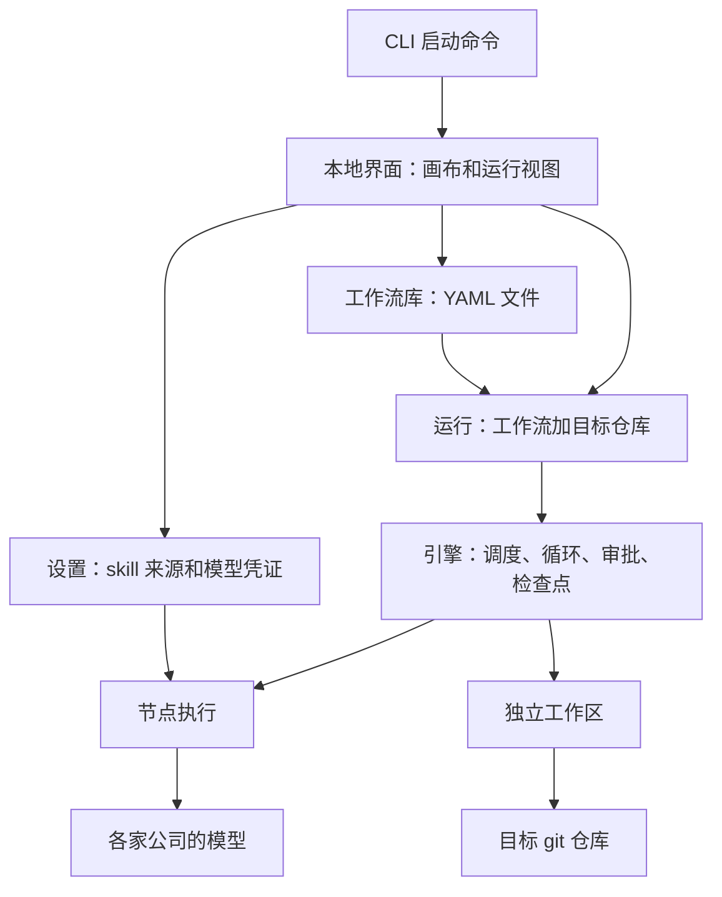

# aipilotAgent 产品规格

Version 1, 2026-10-13. Each later version states what changed and why.

## Summary

aipilotAgent 是一个开源、与领域无关的本地工作流平台。用户在画布上创建并连接节点，自由搭建工作流。每个 agent 节点可以单独选择模型、thinking level 和 skill。不同节点可以使用不同公司的模型。v1 先由作者自用。v1 用两个示例工作流验收：aipilot 代码实现流程和小说写作流程。

## Existing Context

- 平台的起点是 aipilot。aipilot 是 Claude Code 和 Codex 上的文档驱动开发流程插件。
- 作者希望每个阶段跑在最合适的模型上。例如，计划和审查用 Opus，实现用 Sonnet。审查也可以换成别家公司的模型。
- 平台不只服务 aipilot。同一个平台要能搭建开发、写小说等任意领域的工作流。
- 设计起点是 `docs/多模型 Agent 工作流引擎 · Handoff.md`。该文件只作输入，不再修改。本规格取代它的产品部分。技术选择记录在 `memory/decisions.md` 中。
- 目标用户先是开发者。不写代码的创作者以后再服务。
- 用户的工作对象是 git 仓库。代码和小说稿件都是文本，都适合用 git 管理。
- aipilot 的 skill 会读取兄弟 skill 的文件。例如，每个 skill 都读取 `../workflow-orchestrator/references/document-system-spec.md`。
- aipilot 的部分 skill 需要访谈用户，例如 `product-spec-builder`。
- 节点运行时依赖的若干能力尚未验证。验证工作属于计划阶段。

## Scope

#### In scope

- 本地可视化应用。用户用 CLI 启动它，在浏览器中使用。
- 画布搭建：agent 节点、命令节点、依赖连接、执行条件和人工审批。
- 两种容器节点：组节点和 foreach 节点。两者可以任意嵌套。
- 复制和粘贴节点及子图。
- 工作流库。工作流以 YAML 文本保存。
- 设置：注册 skill 来源目录，配置各家模型的凭证。
- 运行：选择工作流和目标 git 仓库，填写输入，启动运行。
- 运行期间：实时状态、交互问答、审批、中止和续跑。
- 运行记录：节点事件、token 用量、费用、产物和 diff。
- 预算控制。预算只计算 LLM 费用。
- 两个示例工作流：aipilot 代码实现流程和小说写作流程。

#### Out of scope

- 手工编辑 YAML。
- 节点模板和子流程复用。
- 图像、视频和语音生成模型。
- 平台服务退出后保留交互会话。
- 并行执行 foreach 的各项。
- 并行执行同一运行中的可写节点。
- 非 git 工作区。
- 沙箱模式和不可信的 skill。
- 多用户、账号、远程访问和分布式执行。
- 通过 CLI 或 CI 触发运行。
- 启动前的费用预估。
- 条件中的任意表达式。
- 命令节点上报费用。
- 公开发布。开源发布在 v1 之后进行。

## Proposed Behavior

### 平台组成

平台由下面几个概念组成：

- **工作流库**：保存用户搭建的工作流。工作流和项目仓库分开。同一个工作流可以用于多个仓库。
- **运行**：一个工作流在一个目标 git 仓库上的一次执行。
- **工作区**：每个运行从目标仓库创建的独立 worktree。
- **产物**：节点写出的文件。节点之间只通过产物和工作区交接，不共享对话。
- **skill 来源**：用户注册的目录。节点从这些目录中选择 skill。

### 节点和容器

| 元素 | 用户可以设置的内容 |
| --- | --- |
| 工作流 | 文本输入、最大并行数、预算 |
| agent 节点 | 模型、thinking level、skill、任务、附加指令、产物、写权限、是否交互、执行条件、是否审批 |
| 命令节点 | 命令、写权限、是否允许非零退出码、执行条件、是否审批 |
| 组节点 | 子图、结束条件、最大轮数、用尽后的处理方式、执行条件、是否审批 |
| foreach 节点 | 子图、列表来源、执行条件、是否审批 |
| 连接 | 上游节点到下游节点的依赖 |

### 用户流程

1. 用 CLI 启动平台。平台打开本地界面。
2. 在设置中注册 skill 来源目录。
3. 在设置中配置各家模型的凭证。
4. 在画布上创建节点，设置属性，再连接节点。
5. 保存工作流。画布实时显示校验错误。
6. 选择工作流和目标 git 仓库，填写输入，启动运行。
7. 查看节点状态。回答交互式节点的问题，处理审批。
8. 如果运行失败或被中止，修正原因后续跑。
9. 在目标仓库中取得运行的改动。

### 执行规则

- 节点的上游全部完成后，节点才启动。
- 同一运行中，一次只运行一个可写节点。
- 平台按 git 状态判断工作区是否有改动。被 git 忽略的文件不算改动。
- 每个 agent 节点使用新的会话。会话只收到任务、skill、附加指令和产物路径。
- 组节点每一轮都重新执行整个子图。
- foreach 节点按列表顺序一次执行一项。后一项能看到前面各项对工作区的改动。

## Acceptance Criteria

### 搭建

- **AC-1 (节点类型):** 当用户在画布上添加节点时，系统应提供 agent 节点、命令节点、组节点和 foreach 节点。
- **AC-2 (节点模型):** 系统应允许每个 agent 节点单独选择模型和 thinking level。
- **AC-3 (跨公司模型):** 系统应允许同一工作流中的节点使用不同公司的模型。
- **AC-4 (节点 skill):** 系统应允许每个 agent 节点从已注册的来源中选择零个或多个 skill。
- **AC-5 (任务和指令):** 系统应允许每个 agent 节点设置任务文本和附加指令。
- **AC-6 (任务引用):** 系统应允许任务文本引用工作流输入、上游产物、本节点的产物路径和 foreach 当前项的字段。
- **AC-7 (产物声明):** 系统应允许节点声明产物文件，并为 JSON 产物指定 JSON schema。
- **AC-8 (写权限):** 系统应把新建的 agent 节点和命令节点默认设为只读，并允许用户改为可写。
- **AC-9 (交互声明):** 系统应允许用户把 agent 节点声明为交互式。
- **AC-10 (命令节点):** 系统应允许命令节点设置一条命令，以及是否允许非零退出码。
- **AC-11 (连接):** 当用户把一个节点连到另一个节点时，系统应把前者记为后者的上游依赖。
- **AC-12 (执行条件):** 系统应允许任意节点设置执行条件。条件判断 JSON 产物的字段是否等于给定值，并可以要求多个条件同时成立。
- **AC-13 (审批):** 系统应允许任意节点设置完成后需要人工审批。
- **AC-14 (组节点):** 系统应允许组节点包含子图，并设置结束条件、最大轮数和用尽后的处理方式。用尽后的处理方式是判为失败或转人工审批。
- **AC-15 (foreach 节点):** 系统应允许 foreach 节点包含子图，并指定一个上游 JSON 数组产物作为列表来源。
- **AC-16 (任意嵌套):** 系统应允许组节点和 foreach 节点互相嵌套，层数不限。
- **AC-17 (复制粘贴):** 当用户复制并粘贴节点或子图时，系统应创建一份独立的副本。
- **AC-18 (工作流设置):** 系统应允许工作流声明文本输入、最大并行数和预算。
- **AC-19 (保存):** 当用户保存工作流时，系统应把它以 YAML 文本存入工作流库。

### 校验

- **AC-20 (校验阻止运行):** 如果工作流有校验错误，那么系统应在画布上标出出错的节点，并禁止启动运行。
- **AC-21 (依赖成环):** 如果依赖连接形成环，那么系统应把它判为校验错误。
- **AC-22 (引用来源):** 如果任务或条件引用的产物不来自祖先节点，那么系统应把它判为校验错误。并行的兄弟节点不算祖先节点。
- **AC-23 (条件字段):** 如果条件引用的不是 JSON 产物的字段，那么系统应把它判为校验错误。
- **AC-24 (容器边界):** 如果容器外的节点直接依赖容器内的节点，那么系统应把它判为校验错误。容器外的节点只能依赖整个容器。
- **AC-25 (模型组合):** 如果节点的模型和 thinking level 组合不受支持，那么系统应把它判为校验错误。
- **AC-26 (skill 缺失):** 如果节点选择的 skill 在已注册的来源中找不到，那么系统应把它判为校验错误。
- **AC-27 (YAML 损坏):** 如果工作流库中的 YAML 文件无法解析，那么系统应在打开时报告错误，并禁止运行该工作流。

### 设置

- **AC-28 (skill 来源):** 当用户注册 skill 来源目录时，系统应列出其中所有 SKILL.md 格式的 skill。
- **AC-29 (skill 文件可读):** 当 agent 节点运行时，系统应让它能读取所选 skill 所在来源目录下的所有文件。
- **AC-30 (只加载所选 skill):** 当 agent 节点运行时，系统应只加载该节点选择的 skill，不自动加载其他 skill 或扩展。
- **AC-31 (凭证保存在本机):** 当用户保存某家模型的凭证时，系统应只把凭证保存在本机。
- **AC-32 (凭证不外泄):** 系统应确保凭证不出现在日志、事件和产物中。
- **AC-33 (凭证范围):** 当运行开始时，系统应只为这次运行用到的模型提供方注入凭证。

### 启动运行

- **AC-34 (启动运行):** 当用户选择工作流和目标 git 仓库、填写输入并启动时，系统应开始一次运行。
- **AC-35 (非 git 目录):** 如果目标目录不是 git 仓库，那么系统应拒绝启动运行。
- **AC-36 (未提交的改动):** 如果目标仓库有未提交的改动，那么系统应在启动前提醒用户：这些改动不会进入运行。
- **AC-37 (独立工作区):** 当运行开始时，系统应从目标仓库当前的 HEAD 创建一个独立的工作区。
- **AC-38 (冻结工作流):** 当运行开始时，系统应保存工作流的副本。之后对工作流的修改不影响这次运行。
- **AC-39 (同时运行):** 系统应允许多个运行同时进行。每个运行使用自己的工作区和预算。

### 执行

- **AC-40 (调度):** 当一个节点的所有上游都已完成时，系统应在最大并行数以内启动它。
- **AC-41 (写入互斥):** 在一个可写节点运行期间，系统应不启动同一运行中的其他可写节点。
- **AC-42 (会话隔离):** 当 agent 节点开始运行时，系统应为它新建会话，不带入其他节点的对话。
- **AC-43 (只读检查):** 如果只读节点运行后工作区有改动，那么系统应撤销这些改动，并把节点判为失败。
- **AC-44 (检查点):** 当可写节点成功时，系统应为工作区记录一个检查点，并生成本节点的 diff 产物。
- **AC-45 (命令产物):** 当命令节点结束时，系统应把它的日志和退出码保存为产物。
- **AC-46 (非零退出码):** 如果命令以非零退出码结束，而节点不允许非零退出码，那么系统应把节点判为失败。
- **AC-47 (产物修正):** 如果 agent 节点缺少声明的产物，或 JSON 产物不符合 schema，那么系统应在同一会话里要求修正，最多 2 次。
- **AC-48 (修正失败):** 如果 2 次修正后产物仍不合格，那么系统应把节点判为失败。
- **AC-49 (API 重试):** 如果模型 API 返回限流或超时错误，那么系统应按退避策略重试。这些重试不计入产物修正的次数。
- **AC-50 (事件记录):** 当 agent 节点运行时，系统应记录每次模型调用和工具调用，以及 token 用量和费用。
- **AC-51 (预算超限):** 如果运行的累计费用超过预算，那么系统应立即停止正在运行的节点，并把运行标记为预算超限。
- **AC-52 (提高预算):** 当用户续跑一个预算超限的运行时，系统应允许用户为这次运行提高预算。
- **AC-53 (条件跳过):** 如果节点的执行条件不成立，那么系统应跳过该节点。
- **AC-54 (跳过传播):** 如果一个节点的所有上游都被跳过，那么系统应也跳过该节点。

### 组节点

- **AC-55 (下一轮):** 当组的一轮结束、结束条件不成立且未达最大轮数时，系统应重新执行组内的整个子图。
- **AC-56 (上一轮产物):** 当组开始新的一轮时，系统应让组内每个节点能读取上一轮组内所有节点的产物。
- **AC-57 (组成功):** 当组的一轮结束且结束条件成立时，系统应把组判为成功。
- **AC-58 (组用尽):** 如果组达到最大轮数而结束条件仍不成立，那么系统应按设置把组判为失败，或转人工审批。
- **AC-59 (批准用尽的组):** 当用户批准一个用尽的组时，系统应把组判为成功。
- **AC-60 (拒绝用尽的组):** 当用户带意见拒绝一个用尽的组时，系统应带着意见再执行一轮。

### foreach 节点

- **AC-61 (顺序执行):** 当 foreach 节点运行时，系统应按列表顺序，一次执行一项的子图。
- **AC-62 (看到前面的项):** 当 foreach 执行下一项时，系统应让它看到前面各项对工作区的改动。
- **AC-63 (空列表):** 如果列表为空，那么系统应直接把 foreach 节点判为成功。
- **AC-64 (列表不是数组):** 如果运行时列表来源不是 JSON 数组，那么系统应把 foreach 节点判为失败。
- **AC-65 (某一项失败):** 如果某一项失败，那么系统应不执行后续各项，并把 foreach 节点判为失败。
- **AC-66 (产物清单):** 当下游节点引用 foreach 节点的产物时，系统应提供一个 JSON 清单。清单按项的顺序列出各项的产物。

### 人工介入

- **AC-67 (提问):** 当交互式节点提问时，系统应在界面上显示问题，并把用户的回答送回同一会话。
- **AC-68 (只有交互式节点能提问):** 系统应只让声明为交互式的 agent 节点向用户提问。
- **AC-69 (关闭页面):** 当用户关闭界面页面时，系统应继续运行。用户重新打开页面后，应看到仍在等待的问题。
- **AC-70 (服务退出):** 如果平台服务在交互式节点等待回答时退出，那么系统应把该节点判为失败。续跑时，该节点从头执行。
- **AC-71 (多个问题):** 当多个交互式节点同时等待回答时，系统应分别显示每个节点的问题。
- **AC-72 (等待审批):** 当需要审批的节点完成时，系统应等待用户批准或拒绝。批准之前，系统应不启动它的下游。
- **AC-73 (其他分支继续):** 在等待审批期间，系统应继续执行不依赖该节点的其他节点。
- **AC-74 (拒绝后重跑):** 当用户带意见拒绝一个节点时，系统应重新执行该节点，并把意见和上一次的产物提供给它。

### 失败、中止和续跑

- **AC-75 (节点失败):** 如果某个节点失败，那么系统应让正在运行的节点跑完，不再启动新节点，并把运行标记为失败。
- **AC-76 (中止):** 当用户中止运行时，系统应停止所有正在运行的节点，并把运行标记为已中止。
- **AC-77 (续跑):** 当用户续跑失败、已中止或预算超限的运行时，系统应先把工作区恢复到最后一个检查点，再从未完成的节点继续。
- **AC-78 (不重跑成功的节点):** 当运行续跑时，系统应不重新执行已成功的节点，也不重新执行 foreach 中已成功的项。
- **AC-79 (崩溃恢复):** 如果平台在运行中崩溃，那么系统应在续跑时以工作区的检查点为准，恢复运行状态。

### 查看

- **AC-80 (实时状态):** 在运行期间，系统应实时显示每个节点的状态。
- **AC-81 (节点详情):** 当用户查看一个节点时，系统应显示它的任务、事件、token 用量、费用、产物和 diff。
- **AC-82 (运行摘要):** 当运行结束时，系统应显示总耗时、总费用和人工介入次数。人工介入包括回答问题、批准和拒绝。
- **AC-83 (运行历史):** 系统应保留运行记录，供用户以后查看。
- **AC-84 (不写入目标仓库):** 系统应不把运行记录写进目标仓库。
- **AC-85 (保留改动):** 当运行结束时，系统应把运行的改动保存在目标仓库中，直到用户删除。

### 平台

- **AC-86 (启动平台):** 当用户执行启动命令时，系统应启动本地服务，并打开界面。
- **AC-87 (本机访问):** 系统应只接受来自本机的界面访问。
- **AC-88 (领域无关):** 系统应不在引擎和节点执行的代码中包含任何具体工作流或领域的逻辑。
- **AC-89 (aipilot 示例):** 当用户只用平台能力搭建 aipilot 示例工作流并运行时，系统应完成从需求访谈到代码审查通过的全过程。
- **AC-90 (小说示例):** 当用户只用平台能力搭建小说示例工作流并运行时，系统应按大纲顺序写完全部章节。

## Assumptions

以下各项都未经用户确认。

- **A-1 (先自用后开源):** v1 先由作者自用。两个示例跑通后，再开源发布。
- **A-2 (预算范围):** 预算只计算 LLM 费用。见 AC-51。
- **A-3 (不做费用预估):** v1 不在启动前预估费用，只在运行中超出预算时停止。
- **A-4 (工作流库):** 工作流保存在平台的工作流库中，与项目仓库分开。用户很快接受了这个推荐。见 AC-19 和 AC-34。
- **A-5 (CLI 的角色):** CLI 只用来启动界面。用户很快接受了这个推荐。见 AC-86。
- **A-6 (交互会话):** 交互式节点的会话一直保持，直到用户回答。见 AC-69 和 AC-70。
- **A-7 (本机单用户):** 界面在本机运行，只有一个用户，不需要账号。见 AC-87。
- **A-8 (运行记录位置):** 运行记录不写进目标仓库。见 AC-84。
- **A-9 (运行起点):** 运行从目标仓库当前的 HEAD 开始。见 AC-36 和 AC-37。
- **A-10 (foreach 规则):** 空列表直接成功。审批对每一项分别生效。续跑时不重跑已成功的项。见 AC-63 和 AC-78。
- **A-11 (目标用户):** 加入画布后，目标用户仍以开发者优先。
- **A-12 (凭证配置):** 用户在平台设置中配置凭证。见 AC-31。
- **A-13 (同时运行):** 多个运行可以同时进行。见 AC-39。
- **A-14 (多个问题):** 多个交互式节点的问题分别显示。见 AC-71。
- **A-15 (中止和续跑):** 用户可以中止运行，之后可以续跑。见 AC-76 和 AC-77。
- **A-16 (冻结工作流):** 运行使用启动时冻结的工作流副本。见 AC-38。
- **A-17 (校验阻止运行):** 有校验错误的工作流不能启动运行。见 AC-20。
- **A-18 (上一轮产物):** 组内节点在下一轮能读取上一轮的全部产物。见 AC-56。
- **A-19 (可信 skill):** v1 只支持可信的 skill，不做沙箱。
- **A-20 (命令节点):** 命令节点也有只读和可写设置。非零退出码默认判为失败，用户可以按节点放开。见 AC-8、AC-10 和 AC-46。
- **A-21 (用尽后的审批):** 批准用尽的组时，组成功。拒绝时，带着意见再执行一轮。见 AC-59 和 AC-60。
- **A-22 (提高预算):** 续跑预算超限的运行时，用户可以提高预算。见 AC-52。

## Open Questions

- **Q-1 (结果交付):** 运行的改动怎样交付到用户的工作分支？用户决定在设计具体工作流时再定。[risk: risks rework]

## Deferred Choices

- [design] 画布布局、节点属性面板、嵌套子图的显示、运行视图、问答界面和审批界面。约束：画布必须能显示任意层嵌套，见 AC-16。运行视图必须实时显示节点状态，见 AC-80。
- [plan] 平台数据的存储位置和格式，包括工作流库、运行记录、设置和凭证。约束：见 AC-19、AC-31 和 AC-84。
- [plan] 运行的改动在目标仓库中的保存方式。约束：见 AC-85。交付方式见 Q-1。
- [plan] 画布、YAML 和界面所用的库。约束：使用 TypeScript，见 `memory/decisions.md`。
- [plan] 节点运行时的接入方式，以及 handoff 中的验证清单。约束：所有运行时调用只出现在 runner 层。
- [plan] 模型单价的来源。约束：费用必须能按节点和运行累计，见 AC-50 和 AC-82。
- [plan] API 重试的次数上限和退避参数。约束：见 AC-49。
- [plan] CLI 的名称和启动命令。约束：见 AC-86。
