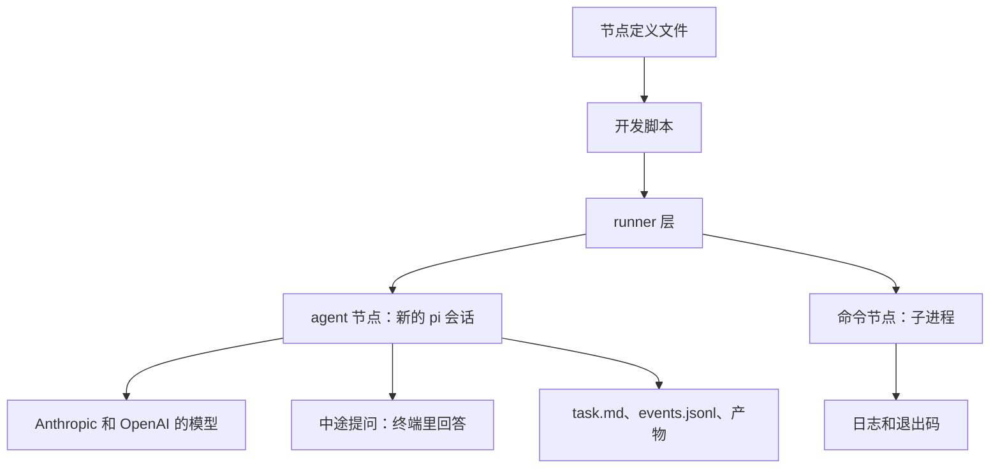

## Quick Overview

> **Summary:** 验证 pi 的关键能力，并实现 runner 层，使它能独立运行单个 agent 节点和单个命令节点。开发者用开发脚本在终端运行节点，查看事件和产物，并回答交互式节点的提问。

| 能力 | 本阶段 | 以后的阶段 |
| --- | --- | --- |
| 运行单个 agent 节点 | 用开发脚本运行 | 第 2 阶段由调度器调用 |
| 运行单个命令节点 | 用开发脚本运行 | 第 2 阶段由调度器调用 |
| 中途提问 | 在终端里回答 | 第 5 阶段在界面里回答 |
| 事件、token 和费用 | 写入 events.jsonl | 第 3 阶段累计到运行，第 5 阶段显示 |
| 产物修正 | 只提供"同一会话继续运行"的能力 | 第 2 阶段由引擎校验产物，并控制修正次数 |
| 凭证 | 使用 pi 自带的登录或环境变量 | 第 5 阶段在设置页配置 |

## Requirement

### Existing Context

- 本 work-item 是 `dev-phase-plan.md` 的第 1 阶段。需求来源是 `product-spec.md` Version 1。
- 项目目录还没有代码，也还不是 git 仓库。
- 本机环境：
  - pi 0.84.3 已全局安装，包名是 `@earendil-works/pi-coding-agent`。
  - npm 上的最新版是 1.2.0，发布于 2026-10-14，是一次大版本升级。用户要求先升级到最新版。
  - Node 24.21.0、npm 11.19.0 和 git 2.56.0 可用。
  - pnpm 没有安装。
- `memory/decisions.md` 已经定下这些技术选择：
  - 使用 TypeScript。
  - 用 pi 执行 agent 节点。
  - runner 层不依赖引擎，所有 pi 调用只出现在 runner 层。
  - 自动化测试不调用真实模型。
- handoff 文档列出了 pi 的六项未验证能力：
  - 按会话设置模型和 thinking level，以及各家提供方的认证；
  - 关闭 skill 自动发现，或只加载指定的 skill；
  - 限定工具集，并注册自定义工具；
  - 事件流中带 token 用量；
  - 同一会话继续发送指令；
  - 正确的包名和会话创建方式。
- 用户有 Claude、ChatGPT 和 Google 三家的订阅，没有 Anthropic API key。
- 本机 pi 0.84.3 的文档 `docs/providers.md` 说明了凭证的情况：
  - pi 用 `/login` 登录，凭证保存在 `~/.pi/agent/auth.json`。文档没有提到复用 Claude Code、Codex 或 Gemini CLI 的登录。
  - Claude Pro/Max 可以登录。第三方工具的用量从 extra usage 中扣除，按 token 计费，不计入订阅额度。
  - ChatGPT Plus/Pro 可以通过 Codex 登录，这是 OpenAI 官方认可的方式。
  - 订阅登录的列表中没有 Google。Google 只能用 Gemini API key。
- 用户决定本阶段只验证 Anthropic 和 OpenAI 两家，暂不使用 Google。
- 用户要求真实模型的测试优先使用便宜的模型，例如 OpenAI 的 `gpt-5.6-luna` 和 Claude Haiku。
- aipilot 的 skill 会读取兄弟 skill 的文件，例如 `../workflow-orchestrator/references/document-system-spec.md`。

### Scope

#### In scope

- 项目脚手架：TypeScript 项目、测试、lint 和类型检查。
- 逐项验证 pi 的六项能力，并记录结论。
- runner 层运行单个 agent 节点：按节点定义设置模型、thinking level、skill、任务和附加指令，每次都新建会话。
- 交互式 agent 节点在运行中提问，回答送回同一会话。
- 事件记录：模型调用、工具调用、token 用量和费用。
- 节点结束后，在同一会话中继续发送指令。
- 模型 API 限流和超时时的退避重试。
- runner 层运行单个命令节点：记录日志和退出码，并按设置判定非零退出码。
- 凭证保护：不出现在日志、事件和产物中，只提供给本节点用到的提供方。
- 开发脚本：在终端运行一个节点定义，并显示交互式节点的提问。
- 按验证结论修订 handoff 中的 StepRunner 接口草案，作为第 2 阶段的输入。

#### Out of scope

- 多节点调度、依赖、条件、审批、组节点和 foreach。这些属于第 2 阶段。
- 引擎对产物的 schema 校验，以及修正次数的控制。这些属于第 2 和第 3 阶段。
- 完整的运行目录、git worktree、检查点、只读检查和预算。这些属于第 3 阶段。
- 凭证设置页和界面中的问答。这些属于第 5 阶段。
- 图像、视频和语音生成模型。
- Google 的模型。用户决定本阶段暂不使用。

### Proposed Behavior

1. 开发者写一个节点定义文件。
   - agent 节点包括：模型、thinking level、skill 来源目录和 skill 名称、任务、附加指令、是否交互、产物文件名。
   - 命令节点包括：命令，以及是否允许非零退出码。
2. 开发者用开发脚本运行这个节点，并指定一个输出目录。
3. runner 把实际发出的任务写入 `task.md`，然后新建会话，只加载所选的 skill，再开始运行。
4. 运行中，runner 把每个事件追加到 `events.jsonl`。
5. 如果节点是交互式的，agent 提问时，开发脚本在终端显示问题和选项。开发者回答后，回答送回同一会话。
6. 节点结束后，产物位于输出目录的 `out/` 下。runner 返回状态、产物路径和用量。
7. 调用方可以在同一会话中追加一条指令，让节点继续运行。
8. 命令节点执行命令，把日志和退出码写成产物。

### Acceptance Criteria

- **AC-1 (模型和 thinking):** 当节点定义指定模型和 thinking level 时，runner 应用该模型和 thinking level 运行节点。来源：product-spec AC-2。
- **AC-2 (两家提供方):** runner 应能分别用 Anthropic 和 OpenAI 的模型运行节点。来源：product-spec AC-3。
- **AC-3 (只加载所选 skill):** 当节点运行时，runner 应只加载节点选择的 skill，不自动加载其他 skill 或扩展。来源：product-spec AC-30。
- **AC-4 (skill 文件可读):** 当节点运行时，agent 应能读取所选 skill 所在来源目录下的所有文件。来源：product-spec AC-29。
- **AC-5 (任务和指令):** 当节点运行时，runner 应把任务文本和附加指令都提供给模型，并把实际发出的任务写入 `task.md`。来源：product-spec AC-5。
- **AC-6 (会话隔离):** 当节点开始运行时，runner 应新建会话，不带入其他会话的对话。来源：product-spec AC-42。
- **AC-7 (提问):** 当交互式节点提问时，runner 应把问题交给调用方，并把调用方的回答送回同一会话。来源：product-spec AC-67。
- **AC-8 (只有交互式节点能提问):** 如果节点不是交互式的，那么 runner 应不给它向用户提问的能力。来源：product-spec AC-68。
- **AC-9 (事件记录):** 当 agent 节点运行时，runner 应把每次模型调用和工具调用，以及 token 用量和费用，追加到 `events.jsonl`。来源：product-spec AC-50。
- **AC-10 (继续会话):** 当调用方在节点结束后发送追加指令时，runner 应在同一会话中继续运行。来源：product-spec AC-47。
- **AC-11 (API 重试):** 如果模型 API 返回限流或超时错误，那么 runner 应按退避策略重试。来源：product-spec AC-49。
- **AC-12 (产物位置):** 当 agent 节点结束时，runner 应返回状态、产物路径和用量。产物位于该节点专用的输出目录的 `out/` 下。来源：product-spec AC-7。
- **AC-13 (命令产物):** 当命令节点结束时，runner 应把日志和退出码保存为产物。来源：product-spec AC-45。
- **AC-14 (非零退出码):** 如果命令以非零退出码结束，而节点不允许非零退出码，那么 runner 应把节点判为失败。来源：product-spec AC-46。
- **AC-15 (凭证不外泄):** runner 应确保凭证不出现在日志、事件和产物中。来源：product-spec AC-32。
- **AC-16 (凭证范围):** 当节点运行时，runner 应只为该节点用到的模型提供方提供凭证。命令节点的子进程应拿不到模型凭证。来源：product-spec AC-33。
- **AC-17 (领域无关):** runner 的代码应不包含任何具体工作流或领域的逻辑。来源：product-spec AC-88。

### Assumptions

以下各项都未经用户确认。

- **A-1 (开发脚本):** 本阶段用开发脚本代替界面来运行节点和回答问题。开发脚本只是验证工具，不是产品功能。
- **A-2 (费用计算):** events.jsonl 中的费用一律按"token 数 × 公开单价"计算。Claude 经 pi 使用时按 token 计费，所以这个值接近实际花费。ChatGPT 订阅不按 token 计费，所以这个值只是折算值。
- **A-3 (凭证来源):** 本阶段的凭证来自 pi 自带的登录或环境变量。

### Deferred Choices

- [plan] pi 的接入方式：进程内 SDK，或子进程调用 pi CLI。约束：所有 pi 调用只出现在 runner 层，而且要满足 AC-1 到 AC-11。
- [plan] 模型单价的来源。约束：费用必须能按节点累计，见 AC-9。
- [plan] API 重试的次数上限和退避参数。约束：见 AC-11。
- [plan] 项目结构和工具链，包括包管理、测试框架和 lint。约束：使用 TypeScript，runner 是一个不依赖引擎的独立包。

## Plan

Execution granularity: per user story/task group
Commit policy: auto
Test tiers: fast `npm run typecheck && npm run lint && npm test` · full `npm run build -w @aipilotagent/runner && npm test -w @aipilotagent/runner` touched modules: @aipilotagent/runner

### Approach Decisions

#### pi 的接入方式 (AC-1 到 AC-11；Deferred Choices 第 1 条)

| Candidate | How it works | Strengths | Weaknesses | Result |
|---|---|---|---|---|
| 进程内 pi SDK | runner 引用已安装的 pi 包，在进程内创建会话 | 复用已安装的依赖；事件和自定义工具都能直接拿到；与 handoff 的 LocalRunner 一致 | SDK 变化快，要锁定版本 | **Chosen** |
| 子进程调用 pi CLI | 每个节点启动一个 pi 进程，用 JSONL 通信 | 进程隔离，和以后的沙箱方式一致 | 提问和继续会话要绕路；输出要解析；新概念更多 | Dropped: 简洁性排名靠后。保留为 SDK 能力不足时的退路 |
| 直接调用各家 API | runner 自己实现 agent 循环和工具 | 不依赖 pi | 要重写工具、skill 和多家认证 | Dropped: 违反 decisions.md 中"用 pi 执行 agent 节点" |
| Claude Agent SDK | 用 Anthropic 的 agent SDK 运行节点 | 成熟 | 只支持 Claude | Dropped: 不满足 AC-2 |

选择者：agent，依据 handoff 和 decisions.md。

Premises:
- (P1) pi SDK 能为每个会话设置模型和 thinking level，并使用对应提供方的认证。
- (P2) pi SDK 能关闭 skill、扩展和上下文文件的自动加载。
- (P3) pi SDK 能注册自定义工具，工具的处理函数可以是异步的。
- (P4) pi SDK 的事件中带有每次模型调用的 token 用量。
- (P5) 会话结束后，pi SDK 能在同一会话中再发送一条指令。

#### 提问机制 (AC-7, AC-8)

| Candidate | How it works | Strengths | Weaknesses | Result |
|---|---|---|---|---|
| 自定义提问工具 | 只给交互式节点注册一个提问工具；处理函数等待调用方的回答 | 问题出现在回合中间，agent 保留上下文；不注册工具就满足 AC-8 | 依赖 P3 和 P6 | **Chosen** |
| 回合结束时提问 | agent 以约定格式结束回合，runner 识别后继续会话 | 只依赖 P5 | 依赖模型遵守格式，不稳定；新概念更多 | Dropped: 简洁性和可靠性排名靠后。保留为退路 |

选择者：agent。

Premises:
- (P6) 提问工具的处理函数等待几分钟，会话也不会超时或中断。

#### 模型单价的来源 (AC-9；Deferred Choices 第 2 条)

| Candidate | How it works | Strengths | Weaknesses | Result |
|---|---|---|---|---|
| pi 的模型元数据 | 从 pi 的模型列表读取每个 token 的价格 | 复用；随 pi 升级更新 | 依赖 P7 | **Chosen** |
| 自己维护单价文件 | 在配置文件中写各模型的单价 | 不依赖 pi | 要手动维护，容易过时 | Dropped: 复用排名靠后。保留为退路 |

选择者：agent。

Premises:
- (P7) pi 的模型元数据包含所用模型的输入和输出 token 单价。

#### API 重试 (AC-11；Deferred Choices 第 3 条)

| Candidate | How it works | Strengths | Weaknesses | Result |
|---|---|---|---|---|
| runner 自己做退避重试 | 在调用 pi 的边界处包一层重试：最多 3 次，间隔 2、4、8 秒，加 ±20% 抖动 | 能用假的适配器做确定性测试；参数由我们控制 | 要写少量新代码 | **Chosen** |
| 只用 pi 内置的重试 | 依赖 pi 自己的重试逻辑 | 复用 | 不制造真实限流就无法验证 AC-11 | Dropped: 计划的检查无法验证它 |

选择者：agent。只对限流和超时重试，其他错误立即失败。

Premises:
- (P8) pi SDK 的错误信息足以区分限流、超时和其他错误。
- (P9) pi 内置的重试可以关闭，或者不存在，所以两层重试不会叠加。

#### skill 的加载方式 (AC-3, AC-4)

| Candidate | How it works | Strengths | Weaknesses | Result |
|---|---|---|---|---|
| runner 注入 SKILL.md | 关闭 pi 的 skill 发现；runner 读取所选 SKILL.md，连同 skill 目录的绝对路径写入系统提示 | 不依赖 pi 的 skill 机制；各家模型的行为一致 | 要写少量新代码 | **Chosen** |
| 用 pi 原生加载指定 skill | 把 skill 路径交给 pi 加载 | 复用 | 依赖 pi 能否只加载指定 skill | Dropped: 违反 handoff 中用户确认的决定：由引擎读取 SKILL.md 注入系统提示 |

选择者：handoff 中的用户决定。

Premises:
- (P10) agent 的读取工具能用绝对路径读取工作目录以外的文件。

#### 工程结构和工具链 (Deferred Choices 第 4 条)

| Candidate | How it works | Strengths | Weaknesses | Result |
|---|---|---|---|---|
| npm workspaces、node:test、tsc、Biome | runner 是 workspace 中的独立包；测试用 Node 自带的测试框架 | 复用已安装的 npm 和 Node 自带功能；依赖最少 | node:test 的功能比 Vitest 少 | **Chosen** |
| pnpm 加 Vitest 加 ESLint | 常见的 TypeScript 组合 | 生态丰富 | pnpm 没有安装；依赖更多 | Dropped: 复用和简洁性排名靠后 |

选择者：用户，在计划问题中确认。

Premises:
- (P11) Node 24 能直接运行项目的 TypeScript 源码，测试和开发脚本都不需要先构建。

### Task Group 1: 脚手架与 pi 能力验证   (AC: AC-1, AC-2, AC-3, AC-7, AC-9, AC-10)
Touches: 仓库根目录、`packages/runner`、`spikes/`
Tests: fast
- [x] Task 1.1: 初始化 git 仓库，加入 `.gitignore`，把现有文档做成初始提交。 — Verify: `git log --oneline` 显示初始提交，`git status` 显示工作区干净。
- [x] Task 1.2: 把全局安装的 pi 升级到 1.3.0。然后搭建 npm workspace：根 `package.json` 的脚本、严格模式的 `tsconfig`、`biome.json`，以及 `packages/runner` 包和一个占位测试。在 runner 包中按确切版本 1.3.0 引用 pi SDK。 — Verify: `pi --version` 显示 1.3.0。`npm run typecheck`、`npm run lint` 和 `npm test` 全部通过。`npm ls @earendil-works/pi-coding-agent` 显示 1.3.0。
- [x] Task 1.3: 确认两家凭证都可用。先列出 `~/.pi/agent/auth.json` 中已有的提供方，只列名称，不显示内容。缺少的提供方，请用户在终端运行 `pi`，用 `/login` 登录 Claude Pro/Max 和 ChatGPT Plus/Pro（Codex）。再在 pi 1.3.0 的文档中复查这些说明。 — Verify: 凭证文件中有 Anthropic 和 OpenAI Codex 两项。Execution Record 记录每家的凭证类型，并引用 pi 文档中关于 Claude extra usage 计费的原文。
- [x] Task 1.4: 写验证脚本 `spikes/pi-capabilities.ts`，用真实模型逐项检查 P1 到 P11，并检查 pi 能否限定工具集。两家提供方都要跑，每家用模型目录中最便宜的模型：Claude 用最新的 Haiku，OpenAI 用 `gpt-5.6-luna`。脚本标记为 throwaway。 — Verify: 运行脚本，在 Execution Record 中引用关键输出。结论表列出每个前提的结果：成立，或不成立及采用的退路。
- [x] Task 1.5: 按验证结论修订 handoff 中的 StepRunner 接口草案，写成 `packages/runner/src/types.ts`。注释写明每个部分依赖哪个前提。 — Verify: `npm run typecheck` 通过。接口覆盖节点定义、调用方回调（事件、提问、中止）和返回结果。
Done when: 结论表覆盖 P1 到 P11，每个前提都成立，或者已有记录的退路。发现的约束已写入 `memory/lessons.md`。快速档通过。

### User Story 2: 运行单个 agent 节点   (AC: AC-1, AC-2, AC-3, AC-4, AC-5, AC-6, AC-9, AC-12, AC-15, AC-16, AC-17)
Touches: `packages/runner/src`、`tools/run-node.ts`
Tests: fast
- [x] Task 2.1: 定义节点定义的类型，并实现 JSON 节点定义的加载和校验。 — Verify: 单元测试覆盖合法定义、缺少模型、未知的 thinking level 和未知的节点类型。规则改变时，测试要失败。
- [x] Task 2.2: 实现 skill 解析和注入：从来源目录找到所选 skill，读取 SKILL.md，把内容和 skill 目录的绝对路径写入系统提示。 — Verify: 单元测试用临时的 skill 来源目录，其中有一个引用兄弟 skill 文件的 SKILL.md。断言提示中包含 SKILL.md 正文和绝对路径。找不到 skill 时，断言报错（AC-3、AC-4）。
- [x] Task 2.3: 实现 pi 会话适配器，所有 pi 调用都放在这里。再实现假的适配器，供测试使用。 — Verify: `npm run typecheck` 通过。在 runner 包中搜索 pi 包的引用，只出现在适配器文件中。
- [x] Task 2.4: 实现 agent 节点运行：每次新建会话；设置模型和 thinking level；注入 skill 和附加指令；写出 `task.md`；把模型调用和工具调用追加到 `events.jsonl`；返回状态、产物路径和用量。 — Verify: 用假适配器的单元测试断言 `task.md` 的内容、`events.jsonl` 的事件类型和用量字段、两次运行使用不同的会话，以及返回结果（AC-5、AC-6、AC-9、AC-12）。
- [x] Task 2.5: 按 pi 的模型元数据计算每次模型调用的费用。 — Verify: 单元测试给定用量和单价，断言事件中的费用正确。缺少单价时，事件标明费用未知，不能写成 0。
- [x] Task 2.6: 实现凭证保护：只给会话提供节点模型所属提供方的凭证；事件和日志不包含凭证。 — Verify: 单元测试设置一个假的密钥，运行假会话，然后检查所有输出文件中都找不到它（AC-15）。断言适配器只收到一个提供方的凭证（AC-16）。
- [x] Task 2.7: 写开发脚本 `tools/run-node.ts`：读取节点定义和输出目录，运行节点，在终端打印事件摘要。 — Verify: 用两家提供方最便宜的模型各运行一次真实节点。在 Execution Record 中引用命令和关键输出，并确认 `task.md`、`events.jsonl` 和 `out/` 中的产物都存在（AC-1、AC-2）。
Done when: 所有任务的 Verify 通过。两家提供方的真实运行都写出了事件和产物，事件中有 token 用量和费用。快速档通过。

### User Story 3: 交互式提问与继续会话   (AC: AC-7, AC-8, AC-10)
Touches: `packages/runner/src`、`tools/run-node.ts`
Tests: fast
- [ ] Task 3.1: 只为交互式节点注册提问工具。工具把问题和选项交给调用方的提问回调，并把回答返回给会话。问题和回答都记为事件。 — Verify: 用假适配器的单元测试断言：交互式节点有提问工具，回答回到同一会话；非交互式节点没有这个工具（AC-7、AC-8）。
- [ ] Task 3.2: 实现继续会话：节点结束后，调用方可以在同一会话中追加一条指令。 — Verify: 用假适配器的单元测试断言追加指令进入同一会话（AC-10）。
- [ ] Task 3.3: 在开发脚本中实现终端问答：显示问题和编号选项，从标准输入读取回答。再加一个参数，运行结束后追加一条指令。 — Verify: 用一个便宜的真实模型运行一个交互式节点。在终端回答问题，再追加一条修正指令。在 Execution Record 中引用问答记录和事件（AC-7、AC-10）。
Done when: 所有任务的 Verify 通过。真实模型的交互式运行完成了一次问答和一次追加指令。快速档通过。

### User Story 4: 命令节点与 API 重试   (AC: AC-11, AC-13, AC-14, AC-16)
Touches: `packages/runner/src`、`tools/run-node.ts`
Tests: fast
- [ ] Task 4.1: 实现命令节点运行：在指定目录执行命令，把日志和退出码写成产物，按设置判定非零退出码。子进程的环境变量中去掉模型凭证。 — Verify: 单元测试断言：非零退出码在不允许时判为失败，在允许时判为成功并保存退出码（AC-13、AC-14）。设置一个假的密钥，让命令打印环境变量，断言日志中找不到这个密钥（AC-16）。
- [ ] Task 4.2: 在适配器边界实现退避重试：只对限流和超时重试，最多 3 次，间隔 2、4、8 秒，加 ±20% 抖动。每次重试记为事件。 — Verify: 单元测试使用可注入的计时器。假适配器连续两次返回限流后成功：断言最终成功，并有两条重试事件。遇到其他错误：断言立即失败（AC-11）。
Done when: 所有任务的 Verify 通过。开发脚本能运行一个命令节点并写出日志和退出码。快速档通过。

### Reuse Notes

- runner 使用 pi SDK：`@earendil-works/pi-coding-agent` 1.3.0，按确切版本锁定。全局安装升级到 1.3.0。
- 测试用 Node 自带的 `node:test`。命令节点用 `child_process`。终端问答用 `readline`。
- 模型单价复用 pi 的模型元数据（P7）。
- skill 注入需要新代码。原因是按 handoff 的决定，不依赖 pi 的 skill 机制。
- 退避重试需要新代码。原因是 pi 内置的重试无法在测试中验证。

### Non-Goals

- 不实现工作流的 YAML 格式。节点定义暂时用 JSON。工作流格式属于第 2 阶段。
- 不实现 FakeRunner。它属于第 2 阶段。本阶段的假适配器只替代 pi 会话，不替代整个 runner。
- 不实现完整的运行目录和 `state.json`。它们属于第 3 阶段。
- 不按写权限限制工具集。本阶段只在验证脚本中检查 pi 能否做到，供第 3 阶段使用。
- 本阶段锁定 pi 1.3.0。阶段内不再升级到更新的版本。

### Exit Criteria (work-item convergence)

- 所有任务组和 story 都已完成。完整档在新的一次运行中通过：`npm run build -w @aipilotagent/runner && npm test -w @aipilotagent/runner`，以及根目录的 `npm run typecheck` 和 `npm run lint`。
- 每条 AC 都能演示：
  - AC-3 到 AC-17 有单元测试。
  - AC-1、AC-2、AC-7 和 AC-10 有真实模型运行的记录，引用在 Execution Record 中。
  - AC-17：在 `packages/runner/src` 中搜索 `aipilot`、`novel`、`chapter`、`story` 和 `review`，没有结果。
- 结论表覆盖 P1 到 P11。修订后的 StepRunner 接口草案已写好，可以作为第 2 阶段的输入。

### Stop Conditions (inherited by every level)
Stop and ask the user when:
- a required decision is missing. Under a Goal Wrap, record the recommended option as an assumption instead.
- verification cannot run.
- the change would exceed Non-Goals.
- a destructive or irreversible action is required.
- Claude 订阅无法通过 pi 使用，例如账号没有开启 extra usage。这时要问用户是开启 extra usage，还是申请 Anthropic API key。
- 某家提供方的凭证不可用，导致 AC-2 无法用真实模型验证。
- pi 1.3.0 有阻塞性的缺陷。这时要问用户是否退回 1.0.0。

## Execution Record

Start: 3407ae0. Commit policy: auto.
本会话确认粒度：per user story/task group。提交策略：auto。

### Task 1.1 — 2026-10-15

- **Changes:** 已有初始提交 `301b0ec`。本会话补交已批准的 `architecture.md`，得到 `3407ae0`。
- **Evidence:** `git log --oneline` 显示 `3407ae0` 和 `301b0ec`。`git status` 显示 working tree clean。

### Task 1.2 — 2026-10-15

- **Changes:** 用户把锁定版本从 1.2.0 改为 1.3.0。全局 pi 升到 1.3.0。搭了 npm workspace、tsc、Biome 和 `@aipilotagent/runner` 占位包。
- **Evidence:** `pi --version` 输出 `1.3.0`。`npm ls @earendil-works/pi-coding-agent` 显示 `1.3.0`。`npm run typecheck`、`npm run lint`、`npm test` 通过。

### Task 1.3 — 2026-10-15

- **Changes:** 只读取凭证提供方名称。未改凭证文件。
- **Evidence:** 提供方名称：`anthropic`、`antigravity`、`codexJ`、`codexM`、`openrouter`、`xai`。`anthropic`、`codexJ`、`codexM` 的 `type` 都是 `oauth`。pi 1.3.0 `docs/settings.md`：`Warn when Anthropic subscription authentication may use paid extra usage.` CHANGELOG：`Anthropic third-party usage draws from extra usage and is billed per token.`

### Task 1.4 — 2026-10-15

- **Changes:** 新增 throwaway 脚本 `spikes/pi-capabilities.ts`。Anthropic 用 `claude-haiku-5-5`。OpenAI 用 `codexJ/gpt-6-luna`。
- **Evidence:** 脚本结论：P1 到 P11 在两家提供方上均为 yes。工具允许名单可以只留 `read` 和 `wait_probe`。`wait_probe` 异步等待 3003ms 会话未中断。`message_end` 带 usage。ChatGPT 单价为 0。
- **Notes:** P6 只验证了 3 秒，没有等几分钟。P8 没有制造真实 429，依据 `isRetryableError` 文档。ChatGPT 登录要加载 `codex-accounts` 扩展。

### Task 1.5 — 2026-10-15

- **Changes:** 写入 `packages/runner/src/types.ts`。接口覆盖节点定义、回调、中止信号和返回结果。
- **Evidence:** `npm run typecheck` 通过。

### Task Group 1 — 2026-10-15

- **Changes:** 完成脚手架和 pi 能力验证。
- **Evidence:** 快速档：`npm run typecheck && npm run lint && npm test` 通过。占位测试 `runner package loads` 通过。
- **Review:** 主代理审查。`clean-context result unavailable`。范围：workspace 脚手架、`types.ts`、throwaway spike。无 P1/P2 缺陷。未把凭证写入仓库。

### User Story 2 — 2026-10-15

- **Changes:** Task 2.1 用 `load-definition.ts` 校验 JSON 模型、thinking、节点类型和 skill 来源。Task 2.2 手动注入所选 SKILL.md 正文与绝对目录；拒绝目录逃逸。Task 2.3 把 pi SDK 调用集中到 `pi-session.ts`，用假适配器做自动化测试；真实运行只向 ModelRuntime 注入本节点提供方的凭证。Task 2.4 实现独立新会话、task.md、逐条追加 events.jsonl、实际文件检查与用量累计。Task 2.5 按模型目录单价计算费用，缺价（含 Codex 零单价）显示 unknown。Task 2.6 测试假密钥不出现在产物或事件中，保护错误消息中的已知密钥。Task 2.7 写 CLI，真实运行 Anthropic 和 Codex。
- **Tests:** 加载器的合法、缺模型、未知 thinking/类型测试固定校验规则；skill 测试固定只选中目标及兄弟目录路径；fake session 测试固定隔离、事件顺序、费用累计、缺产物失败、文件路径边界和假凭证泄漏；凭证存储单测固定提供方过滤。测试不调用真实模型。
- **Evidence:** `npm run typecheck && npm run lint && npm test` 通过，18 tests passed；`npm run build -w @aipilotagent/runner` 通过。`rg '@earendil-works/pi-coding-agent' packages/runner/src` 只显示 `pi-session.ts`。`rg -i 'novel|chapter|story|review' packages/runner/src` 无结果；`aipilot` 仅出现在既有包名常量及既有占位测试，不是工作流领域逻辑。
- **Evidence:** 最终真实运行：`node --experimental-strip-types tools/run-node.ts --definition <临时JSON> --output <临时目录>`。Anthropic `anthropic/claude-haiku-5-5` 输出目录 `/tmp/story2-final-out-cTXEMJ`，status=succeeded、2 条 model + 1 条 tool、token 字段齐全、首条费用 $0.00006454。Codex `codexJ/gpt-6-luna` 输出目录 `/tmp/story2-final-out-Wovnqz`，status=succeeded、2 条 model + 1 条 tool、token 字段齐全、费用 unknown（目录单价全为 0）。两次运行都确认 task.md、events.jsonl、out/result.txt 存在且 result.txt 内容为 OK。
- **Review:** 主代理自审；`clean-context result unavailable`。范围：Story 2 新增源码/测试/CLI、runner 类型和工具配置。发现并修复了初稿的凭证未隔离、事件只在回合结束后写入、多次调用用量未累计、缺产物仍成功、输出路径可逃逸及 Codex 模型定价查询在扩展加载前执行的问题；随后重跑原单测、快速档和两家真实模型，均通过。未调用子代理（当前用户未授权委派）。
- **Notes:** 延后交互提问、继续会话和退避重试到 Story 3/4；命令节点暂为未实现。凭证隔离仅限 pi ModelRuntime，OAuth 刷新目前只在内存；真实读工具尚无 OS 沙箱，不能把假密钥单测解释为对任意恶意模型输出的防泄漏证明。详见 `memory/lessons.md`。下一单位：User Story 3。
