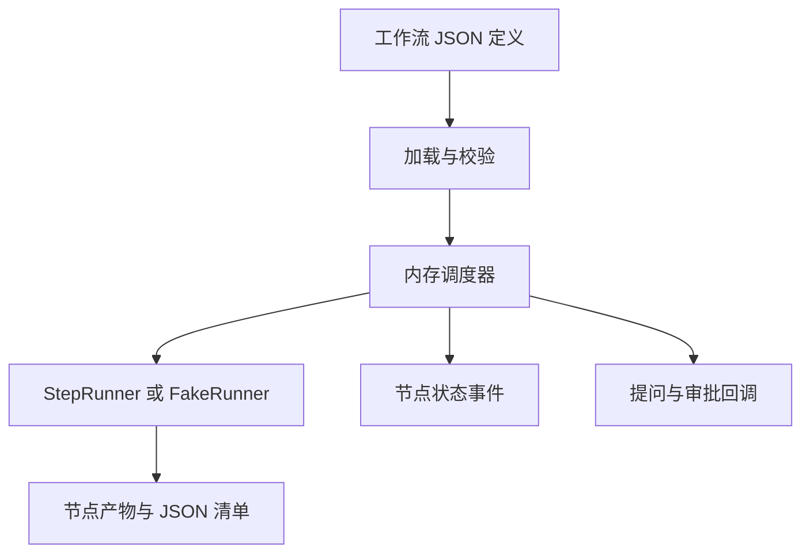

## Quick Overview

> **Summary:** 在已验证的单节点 runner 上建立工作流定义、校验和内存调度核心。开发脚本通过 FakeRunner 展示节点状态变化；持久化、git 工作区和浏览器界面留给后续阶段。

| 能力 | 本阶段 | 后续阶段 |
| --- | --- | --- |
| 工作流控制结构 | 依赖、条件、组、foreach、审批 | 第 6 阶段的可视化编辑 |
| 执行状态 | 进程内状态与回调 | 第 3 阶段的持久化与续跑 |
| 工作区 | 调用方提供的目录 | 第 3 阶段的 git worktree 与检查点 |
| 调试入口 | JSON 定义与 FakeRunner 脚本 | 第 4 阶段的服务接口 |

## Requirement

### Existing Context

- 本 work-item 来自 `dev-phase-plan.md` 的 Phase 2；来源为 `product-spec.md` Version 1。
- Phase 1 已提供独立的 `StepRunner`，包括 agent、命令、提问、继续会话和事件。
- 自动化测试使用 FakeRunner；本阶段不依赖真实模型。

### Scope

#### In scope

- 定义、加载和校验包含依赖、条件、审批、组和 foreach 的工作流。
- 解析工作流输入、祖先产物、本节点产物路径和 foreach 当前项的任务引用。
- 校验循环依赖、引用祖先、JSON 条件字段、容器边界、模型和 skill。
- 调度并发、全局写入互斥、失败停止新节点及中止正在运行的节点。
- 校验 agent 产物的存在性与 JSON schema；同一会话最多修正两次。
- 组节点逐轮执行，保留上一轮产物，处理用尽后的失败或人工审批。
- foreach 顺序执行，汇总 JSON 清单，并支持任意层的组与 foreach 嵌套。
- FakeRunner 自动化测试与输出状态变化的开发脚本。

#### Out of scope

- YAML 文件保存、工作流库和画布校验展示：第 4、6 阶段。
- git worktree、只读改动撤销、检查点、持久化、崩溃恢复、续跑及预算：第 3 阶段。
- 浏览器交互和审批界面：第 5 阶段。
- 真实模型的多节点验收：第 3 阶段。

### Acceptance Criteria

- **AC-1 (依赖及并发):** 当节点的所有上游完成时，调度器应在最大并行数内运行它；可写节点不得同时运行。来源：产品 AC-40、AC-41。
- **AC-2 (条件及跳过):** 当 JSON 条件不成立时，调度器应跳过节点；当所有上游都跳过时，也应跳过节点。来源：产品 AC-12、AC-53、AC-54。
- **AC-3 (引用):** 当任务引用输入、祖先产物、本节点产物路径或 foreach 当前项时，调度器应解析引用。来源：产品 AC-6。
- **AC-4 (校验):** 当定义存在循环、非祖先引用、非 JSON 条件、跨容器依赖、无效模型组合或缺失 skill 时，加载应报错并拒绝运行。来源：产品 AC-20 至 AC-27。
- **AC-5 (产物修正):** 当产物缺失或 JSON schema 校验失败时，调度器应在同一会话最多请求两次修正；仍失败则节点失败。来源：产品 AC-7、AC-47、AC-48。
- **AC-6 (审批):** 当节点需要审批时，下游应等待；其他独立分支可继续。拒绝时，节点应收到意见与上次产物并重新执行。来源：产品 AC-72 至 AC-74。
- **AC-7 (组循环):** 当组未达到结束条件且未用尽轮数时，应重跑整个子图，并让下一轮读取上一轮产物。达到条件时组成功；用尽时按配置失败或等待审批，拒绝后再执行一轮。来源：产品 AC-14、AC-55 至 AC-60。
- **AC-8 (foreach):** foreach 应顺序运行各项；空列表成功，非数组失败，单项失败后不运行后续项；下游应取得按项排序的 JSON 产物清单。来源：产品 AC-15、AC-61 至 AC-66。
- **AC-9 (任意嵌套):** 当组和 foreach 互相嵌套时，调度器应按相同规则运行，不预设层数上限。来源：产品 AC-16。
- **AC-10 (失败和中止):** 当节点失败时，已启动的节点应结束但不得启动新节点；中止时应停止正在运行的节点。来源：产品 AC-75、AC-76。
- **AC-11 (领域无关):** 引擎和节点执行代码应不包含具体领域的流程逻辑。来源：产品 AC-88。
- **AC-12 (状态事件):** 当节点状态变化时，开发脚本应输出每个节点的状态变化，供阶段结果检查。来源：Phase 2 可验收结果；产品 AC-80。

### Assumptions

以下约定来自现有 JSON 开发脚本与 Phase 2 的内存边界，未经用户确认。

- **A-1 (定义格式):** 本阶段用 JSON 加载定义；YAML 保存属于后续阶段。
- **A-2 (引用语法):** 使用 `${inputs.key}`、`${nodes.id.file}`、`${outputs.file}`、`${item.key}` 和 `${previous.id.file}`。JSON 字段用 `#/field`。节点 ID 不得与同级或容器祖先重复；输出引用指向依赖祖先。首轮缺失的 `previous` 值为空字符串。
- **A-3 (容器产物):** 组导出末轮子节点的 JSON 清单；foreach 导出按项排列的 JSON 清单，统一命名为 `manifest.json`。
- **A-4 (内存边界):** 运行记录仅在进程内，调用方提供目录和人工回调；进程退出不提供续跑。
- **A-5 (拒绝次数):** 人工拒绝后重跑不设置隐式次数上限；调用方可中止。
- **A-6 (能力目录):** 加载方传入可用模型与 thinking level 的目录；引擎在读取文件时验证所选 skill。
- **A-7 (缺失条件产物):** 如果条件引用的上游已跳过，没有产物，条件结果为不成立。

## Plan

Execution granularity: whole work-item
Commit policy: auto
Test tiers: fast `npm run typecheck && npm run lint && npm test` · full `npm run build -w @aipilotagent/runner && npm test -w @aipilotagent/runner && npm run build -w @aipilotagent/engine && npm test -w @aipilotagent/engine` touched modules: @aipilotagent/runner, @aipilotagent/engine

### Approach Decisions

#### 独立引擎包与复用 runner (AC-1 至 AC-10)

| Candidate | How it works | Strengths | Weaknesses | Result |
| --- | --- | --- | --- | --- |
| 独立 engine 包依赖 runner 类型 | 调度器注入 StepRunner；不直接接触 pi | 保持既定边界；FakeRunner 可测试 | 需要增加包 | **Chosen** |
| 在 runner 内扩充调度 | 直接复用内部调用 | 文件少 | 违反 runner 不依赖引擎的决策 | Dropped: 违反既有边界 |
| 引入第三方调度框架 | 委托状态与图执行 | 内置部分调度 | 嵌套及审批需要适配 | Dropped: 复用与简单性排名靠后 |

Premises:
- (P1) StepRunner 接口支持同一会话产物修正、并发节点和外部中止。
- (P2) 现有 `typebox/value` 能检查本阶段 JSON schema。

### User Story 1: 定义与加载校验   (AC: AC-3, AC-4, AC-11)
Tests: full
- [x] Task 1.1: 定义工作流节点、引用和执行输入类型，并校验结构、ID、依赖及成环。 — Verify: engine 加载测试覆盖非法定义与有效嵌套。
- [x] Task 1.2: 校验祖先引用、JSON 条件、模型组合和 skill，并解析任务引用。 — Verify: engine 校验与引用测试覆盖接受及拒绝路径。
Done when: 校验错误在执行前被拒绝，引用可由同级祖先或容器祖先解析。

### User Story 2: 调度与控制   (AC: AC-1, AC-2, AC-6, AC-10, AC-12)
Tests: full
- [x] Task 2.1: 注入 StepRunner，调度依赖、跳过和全局写锁，输出状态事件。 — Verify: engine 调度测试验证并发顺序与状态迁移。
- [x] Task 2.2: 处理审批、拒绝重跑、失败和中止。 — Verify: engine 控制测试覆盖独立分支、失败屏障和 AbortSignal。
Done when: 有限并发下的独立分支可推进；失败不启动新节点；中止停止正在执行的节点。

### User Story 3: 产物、循环与嵌套   (AC: AC-5, AC-7, AC-8, AC-9)
Tests: full
- [x] Task 3.1: 校验产物及 schema，在同一会话完成两次修正。 — Verify: engine 产物测试覆盖缺失、损坏及修正次数。
- [x] Task 3.2: 运行组循环、前轮引用与用尽审批。 — Verify: engine 组测试覆盖成功、失败和拒绝多跑一轮。
- [x] Task 3.3: 顺序运行 foreach，输出清单并运行交错嵌套。 — Verify: engine foreach 测试覆盖空、非数组、失败及多层嵌套。
Done when: 嵌套容器均遵守相同的节点执行规则，产物引用和清单可读。

### User Story 4: 可观察的开发入口   (AC: AC-12)
Tests: fast
- [x] Task 4.1: 用 FakeRunner 驱动示例工作流，并打印每个节点的状态变化。 — Verify: 运行开发脚本并核对终态。
Done when: 脚本无需模型凭证即可展示依赖节点的状态变化和最终结果。

### Reuse Notes

- 复用 `@aipilotagent/runner` 的 StepRunner、单节点定义及错误边界。
- 复用已安装的 `typebox/value` 校验 schema；无需新依赖。
- 新的 engine 包只负责工作流定义、校验和内存调度；runner 不依赖 engine。

### Non-Goals

- 本阶段不实现持久化、恢复或真实仓库工作区。
- 本阶段不实现 YAML 编辑、浏览器交互或真实模型多节点验收。

### Exit Criteria (work-item convergence)

- 所有任务完成，完整档 fresh 通过：runner 和 engine 各自的 `npm run build -w` 与 `npm test -w`。
- 快速档 fresh 通过：`npm run typecheck && npm run lint && npm test`。
- AC-1 至 AC-12 由 FakeRunner 自动化测试与开发脚本验证。

### Stop Conditions (inherited by every level)

Stop and ask the user when:
- a required decision is missing. Under a Goal Wrap, record the recommended option as an assumption instead.
- verification cannot run.
- the change would exceed Non-Goals.
- a destructive or irreversible action is required.
- 核心调度行为与已确认的产品规格冲突，必须修改已确认的需求。

## Execution Record

Start: c332944. Commit policy: auto. 当前分支：main。Goal 模式执行粒度：whole work-item。

### User Story 1 — 2026-10-15

- **Changes:** Task 1.1 新增 engine 包、工作流模型、JSON 加载与依赖环校验。Task 1.2 校验引用、模型组合、skill 和 JSON 字段，并实现任务引用解析。
- **Tests:** 新增 `load-workflow.test.ts`，验证定义边界、容器隔离和祖先引用；原有 runner 测试不覆盖多节点定义。
- **Evidence:** `npm test -w @aipilotagent/engine`：25 tests，25 pass；其中加载测试 15 项全部通过。`npm run build -w @aipilotagent/runner && npm test -w @aipilotagent/runner && npm run build -w @aipilotagent/engine && npm test -w @aipilotagent/engine`：runner 38 pass，engine 25 pass。

### User Story 2 — 2026-10-15

- **Changes:** Task 2.1 实现依赖调度、跳过传播、全局并发和可写互斥。Task 2.2 实现审批等待、意见重跑、失败屏障及中止。
- **Tests:** 新增 `run-workflow.test.ts`，验证调度器状态与并发；原有 runner 测试只覆盖单节点。扩展 `command-node.test.ts`，覆盖拒绝反馈和上次产物路径进入命令环境。
- **Evidence:** `npm test -w @aipilotagent/engine`：依赖、跳过、互斥、审批、失败、中止测试通过；25/25。`npm test -w @aipilotagent/runner`：新增命令反馈测试通过；38/38。完整档构建与两包测试通过。

### User Story 3 — 2026-10-15

- **Changes:** Task 3.1 用 `typebox/value` 检查 JSON schema，并在同一会话最多修正两次。Task 3.2 实现组轮次、前轮引用及用尽审批。Task 3.3 实现顺序 foreach、清单、失败边界及交错嵌套。
- **Evidence:** `npm test -w @aipilotagent/engine`：产物、组和 foreach 测试通过；25/25。完整档构建与两包测试通过。

### User Story 4 — 2026-10-15

- **Changes:** Task 4.1 新增 `tools/run-workflow.ts`，用 FakeRunner 打印状态。
- **Evidence:** `node --experimental-strip-types tools/run-workflow.ts`：`seed: pending → running → succeeded`，`finish: pending → running → succeeded`，`workflow: succeeded`。

### Verification — 2026-10-15

- **Evidence:** `npm run typecheck && npm run lint && npm test`：通过；Biome 检查 37 files，无告警；runner 38/38、engine 25/25。
- **Evidence:** `git diff --check`：无空白错误。`check-mermaid.js`：work-item 的 1 个 Mermaid 块通过。
- **Notes:** 不引入第三方调度框架，原因是现有 StepRunner 已足够；YAML、持久化和真实模型多节点运行留在后续阶段。

### Review Round 1 & Fixes — 2026-10-15

- **Review:** Clean-context 独立审查返回以下待修复项：
  1. P2 (Story 1): `load-workflow.ts` 允许子节点 ID 与其容器祖先相同，违反 A-2。
  2. P1 (Story 2): `run-workflow.ts` 在释放容量前未置停止标记，排队节点可能在失败后抢占启动。
  3. P1 (Story 2): 全局停止标记中断了已在运行中的 group 或 foreach 容器，违反 AC-10/AC-75。
  4. P1 (Story 2/3): 容器节点被人工拒绝后，重跑未把 feedback 与上一轮产物传入容器内部作用域。
  5. P1 (Story 3): 无 schema 的声明产物未在磁盘校验存在性，丢失产物未触发修正。
  6. P2 (Final): AC-8 缺少下游节点读取 foreach 顺序 manifest 字段的断言测试。
  7. P1 (Final): 最终 Exit Criteria 要求改动完全收敛后给出 fresh 完整档证据。
- **Changes:**
  1. 在 `validateGraph` 递归校验中加入 `containerIds` 集合，拒绝与容器祖先同名的节点。
  2. 节点失败时先置停止状态再 `release()`，等待容量的节点通过 `canStart()` 返回 `{ state: "pending" }`，不启动也不创建目录。
  3. 失败屏障限定于未启动的节点；已启动的 group/foreach 容器不受兄弟节点失败中断，正常跑完其子节点。
  4. 容器人工拒绝后将 `feedback` 注入其作用域，叶子节点与命令节点重跑时均可读取到反馈。
  5. `validateOutputs` 对所有声明产物先执行 `lstat` 正规文件检查，缺失时触发最多两次会话修正。
  6. `run-workflow.test.ts` 增加下游 `consumer` 节点消费 `${nodes.each.manifest.json#/1/index}` 并断言 `manifest` 索引顺序 `[0, 1, 2]`。
  7. 新增 5 个针对性回归测试（容器同名、排队阻断、运行中容器完成、容器拒绝反馈、无 schema 缺失文件修正）。
- **Evidence:**
  - `npm run build -w @aipilotagent/runner && npm test -w @aipilotagent/runner && npm run build -w @aipilotagent/engine && npm test -w @aipilotagent/engine`：两包构建通过；runner 38 tests 全部通过，engine 30 tests 全部通过。
  - `npm run typecheck && npm run lint && npm test`：类型检查通过；Biome 检查 37 文件无错误无告警；总计 68 项自动化测试全部通过。
  - `node --experimental-strip-types tools/run-workflow.ts`：状态打印完整，终态 `workflow: succeeded`。
  - `git diff --check`：无空白格式错误。

### Completion — 2026-10-15

- **Exit Criteria evidence:**
  - 完整档构建与测试：`npm run build -w @aipilotagent/runner && npm test -w @aipilotagent/runner && npm run build -w @aipilotagent/engine && npm test -w @aipilotagent/engine` 全部通过。runner 38 项通过，engine 30 项通过。
  - 快速档校验与测试：`npm run typecheck && npm run lint && npm test` 全部通过。Biome 检查 37 文件无错误无告警。总计 68 项自动化测试全部通过。
  - 开发脚本验收：`node --experimental-strip-types tools/run-workflow.ts` 正常打印 `seed`、`finish` 的状态事件，终态输出 `workflow: succeeded`。
  - 独立代码审查第 2 轮对全量改动、AC-1 至 AC-12 及退出标准复核通过（`Verdict: PASS`，`Merge verdict: OK`）。
- **Required setup:** Node >= 24，使用 npm workspaces。无需新增外部生产依赖。
- **QA checklist:** 本阶段为引擎核心与调度基础设施，无终端用户 UI 界面。
- **Remaining Risks:**
  - 本阶段在 FakeRunner 上验证内存状态模型与调度逻辑；真实多节点模型调用、git worktree 工作区、检查点及持久化续跑属于 Phase 3。
  - 进程退出时的状态保留与崩溃恢复留待 Phase 3 实现。

