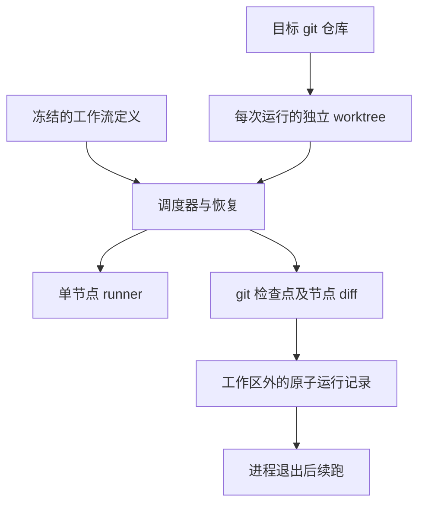

## Quick Overview

> **Summary:** 从目标仓库 HEAD 创建独立 worktree，把节点检查点和运行状态持久化。进程中断后以 git 检查点为准续跑，并用真实模型验证多节点运行。

| 能力 | Phase 2 | 本阶段 |
| --- | --- | --- |
| 工作区 | 调用方提供目录 | 每个运行独立 git worktree |
| 状态 | 进程内 | 工作区外的原子记录与冻结定义 |
| 续跑 | 无 | 按最后检查点恢复，跳过已完成节点和 foreach 项 |
| 验收 | FakeRunner | 临时 git 仓库测试与真实模型多节点脚本 |

## Requirement

### Existing Context

- 来源：`product-spec.md` Version 1，`dev-phase-plan.md` Phase 3。
- Phase 1 的 runner 提供 pi 会话、命令和事件；Phase 2 的 engine 提供内存 DAG 调度、容器和审批。
- 运行状态用文件存储；目标仓库必须是 git 仓库。自动化测试不得调用真实模型。

### Scope

#### In scope

- 校验目标 git 仓库；提示未提交改动，但从 HEAD 建立运行专属 worktree。
- 冻结定义与输入，在目标仓库外持久化运行状态、事件、产物路径和费用。
- 只读节点改动检查与撤销；可写节点成功后的 git 检查点与节点 diff。
- 文件原子写入，检查点优先的中断恢复，失败、中止和预算超限后续跑。
- 预算超限中止正在运行的节点；续跑时可提高预算。
- 用临时 git 仓库与 FakeRunner 验证异常路径；真实模型多节点手动验收。

#### Out of scope

- 平台服务、浏览器 UI 和 YAML 工作流库：Phase 4 至 6。
- 将运行分支合并到用户正在工作的分支：产品 Q-1 尚未确定。
- 跨进程恢复同一 pi 会话：服务退出后等待回答的节点从头执行。
- 非 git 工作区、OS 沙箱和不可信 skill。

### Acceptance Criteria

- **AC-1 (仓库启动):** 当目标目录不是 git 仓库时，运行应拒绝启动；有未提交改动时，应提示其不进入运行。来源：产品 AC-35、AC-36。
- **AC-2 (隔离与冻结):** 当运行启动时，应从目标仓库 HEAD 创建独立 worktree，冻结工作流和输入；多个运行互不共用工作区和预算。来源：产品 AC-37 至 AC-39。
- **AC-3 (只读):** 如果只读节点修改了未忽略的工作区文件，系统应撤销该节点改动并判为失败；被忽略的文件不算改动。来源：产品 AC-43。
- **AC-4 (检查点):** 当可写节点成功时，系统应记录 git 检查点和节点 diff；检查点写入应先于原子状态更新。来源：产品 AC-44、路线图 Review Strategy。
- **AC-5 (记录):** 当运行状态、事件或费用变化时，应将记录保存在目标工作区外；运行结束后保留工作区改动，直到用户删除。来源：产品 AC-50、AC-83 至 AC-85。
- **AC-6 (预算):** 如果累计已知模型费用超过预算，应立即中止正在运行的节点，并把运行标为预算超限；续跑允许提高预算。来源：产品 AC-51、AC-52。
- **AC-7 (续跑):** 当失败、中止或超预算运行续跑时，应恢复最后检查点，不重跑成功节点和 foreach 成功项。来源：产品 AC-77、AC-78。
- **AC-8 (崩溃恢复):** 如果进程在检查点或状态写入时退出，那么续跑应以 git 检查点为准恢复状态。来源：产品 AC-79。
- **AC-9 (交互退出):** 如果服务在等待回答时退出，那么续跑应使该节点从头执行，而不是继续原会话。来源：产品 AC-70。
- **AC-10 (真实验收):** 当开发脚本在示例 git 仓库用真实模型运行多个节点时，应能产生节点事件、工作区检查点和 diff。来源：Phase 3 可验收结果；产品 AC-34、AC-44。
- **AC-11 (领域边界):** 引擎与 runner 不应包含具体工作流或领域逻辑。来源：产品 AC-88。

### Assumptions

以下约定由 Goal 模式按现有文件与代码推断，未经用户确认。

- **A-1 (保存位置):** 每次运行在调用方指定的运行目录保存记录与产物；目录必须在目标仓库及 worktree 外。
- **A-2 (保留改动):** 每次运行创建独立 `aipilot/run-<id>` 分支和 worktree，结束后不自动合并或删除。
- **A-3 (恢复凭据):** 运行记录不保存凭证；续跑从可信宿主重新提供所需凭证与回调。
- **A-4 (未知价格):** 费用未知时不将其误算为零；配置预算的运行若不能获得费用，就停止并报告不可验证的预算。
- **A-5 (中断尝试):** 非成功节点的会话不跨进程保存；续跑从新会话执行该节点。
- **A-6 (git 冲突):** 只撤销运行专属 worktree 中的未检查点改动，不重置目标仓库原工作区。

## Plan

Execution granularity: whole work-item
Commit policy: auto
Test tiers: fast `npm run typecheck && npm run lint && npm test` · full `npm run build -w @aipilotagent/runner && npm test -w @aipilotagent/runner && npm run build -w @aipilotagent/engine && npm test -w @aipilotagent/engine` touched modules: @aipilotagent/runner, @aipilotagent/engine

### Approach Decisions

#### Git 工作区与运行记录 (AC-2, AC-4, AC-5, AC-8)

| Candidate | How it works | Strengths | Weaknesses | Result |
| --- | --- | --- | --- | --- |
| git worktree + 原子 JSON 快照 + 提交元数据 | 每次成功节点先提交带路径元数据的检查点，后原子替换快照 | 符合 git 优先及既有文件决策；无需新依赖 | 需对崩溃窗口做恢复校验 | **Chosen** |
| SQLite 状态加 git worktree | 数据库保存状态和事件 | 查询便利 | 违反文件存储决策，仍需跨 git 事务 | Dropped: 现有决策 |
| 在目标工作分支直接执行 | 直接 git commit | 实现少 | 污染用户工作区，违反 AC-37 | Dropped: 安全门槛 |

Premises:
- (P1) 每次运行的专属 worktree 和分支可在退出后保留。
- (P2) git commit 可携带节点路径供快照滞后时恢复。
- (P3) `StepRunner` 输出目录可与 worktree 分离，调用方可组合 runner 与 engine。

#### 工作区读写归属 (AC-3, AC-4)

| Candidate | How it works | Strengths | Weaknesses | Result |
| --- | --- | --- | --- | --- |
| 持久化运行中串行使用共享 worktree | 节点占用工作区期间不运行其他节点 | 归属明确，防止只读节点撤销他人写入 | 同一运行内无并行节点 | **Chosen** |
| 并发写入与只读快照对比 | 节点同时访问同一个 worktree | 并行度高 | 无法证明改动归属，误撤销风险 | Dropped: 数据损失门槛 |

Premises:
- (P4) 产品最大并行数是上限；串行是此阶段保守的安全策略。

### User Story 1: 独立仓库运行及检查点   (AC: AC-1, AC-2, AC-3, AC-4, AC-5, AC-11)
Tests: full
- [x] Task 1.1: 在独立模块建立运行专属 worktree 和分支，检查目标 git 状态并冻结定义与输入。 — Verify: 临时仓库测试覆盖非 git、脏工作区提示、运行隔离与冻结。
- [x] Task 1.2: 检查只读节点改动并撤销；为成功的可写节点提交检查点和 diff。 — Verify: 临时仓库测试覆盖被忽略文件、只读失败和逐节点提交。
Done when: 目标仓库原工作区保持不变；运行目录外持有独立 worktree，成功写入带路径检查点。

### User Story 2: 持久化与预算   (AC: AC-4, AC-5, AC-6, AC-8)
Tests: full
- [x] Task 2.1: 将状态、用量和事件写入运行目录，以先 git 后原子快照顺序记录成功节点。 — Verify: FakeRunner 测试在提交和快照间模拟失败并恢复。
- [x] Task 2.2: 在模型费用超出预算时取消所有活跃节点，并验证续跑提高预算。 — Verify: FakeRunner 测试覆盖超额、未知费用与预算提高。
Done when: 崩溃窗口可按 git 历史重建成功节点；未提交改动不污染检查点。

### User Story 3: 中断与续跑   (AC: AC-7, AC-8, AC-9)
Tests: full
- [x] Task 3.1: 由快照与检查点恢复 DAG、组及 foreach 的成功路径，并从头启动未完成节点。 — Verify: 中断、失败及模拟崩溃测试证明成功叶子和 foreach 项不重跑。
- [x] Task 3.2: 续跑前恢复到最新检查点，并处理运行时等待回答的中断。 — Verify: 临时仓库集成测试证明孤儿改动被清理且交互节点从头执行。
Done when: 中断后从最后检查点继续，成功路径和 foreach 项保持原有产物与结果。

### User Story 4: 真实多节点验收入口   (AC: AC-10, AC-11)
Tests: fast
- [x] Task 4.1: 提供真实 pi runner 的本地开发脚本，使用小模型在示例 git 仓库执行多节点。 — Verify: 手动运行并检查事件、检查点、diff 和工作区分支。
Done when: 一次真实模型运行完成两个有依赖的节点，留下可检查的 git 结果。

### Reuse Notes

- 复用 `runWorkflow`、`StepRunner`、pi session adapter 和 npm workspace；不调用 runner 之外的 pi API。
- 用 Node 文件系统原子 rename 与 git CLI 管理检查点，不加入数据库或 git 封装依赖。
- 现有 engine 没有磁盘状态和 git 边界；新增独立模块负责这些能力。

### Non-Goals

- 不建立 HTTP 服务、工作流库、YAML 或 UI。
- 不自动合并工作分支，也不清理运行专属 worktree。
- 不承诺 OS 级隔离：可信节点仍可访问本机文件。

### Exit Criteria (work-item convergence)

- 所有任务完成，完整档 fresh 构建与测试通过。
- 快速档 fresh 通过；AC-1 至 AC-11 有临时仓库测试与真实模型验收证据。
- 崩溃窗口、只读撤销、foreach 成功项跳过及预算中止在测试中独立断言。

### Stop Conditions (inherited by every level)

Stop and ask the user when:
- a required decision is missing. Under a Goal Wrap, record the recommended option as an assumption instead.
- verification cannot run.
- the change would exceed Non-Goals.
- a destructive or irreversible action is required.
- 任何方案可能重置目标仓库的原工作区或丢失既有用户改动。

## Execution Record

Start: 3359d09. Commit policy: auto. 当前分支：main。Goal 模式执行粒度：whole work-item。

### User Story 1 — 2026-10-15

- **Changes:** Task 1.1 在 `packages/engine/src/workspace.ts` 中实现 `validateRepository` 校验目标 git 仓库与未提交改动检查，实现 `createWorkspace` 从 HEAD 创建专属 `aipilot/run-<id>` worktree 分支，在 `durable-run.ts` 冻结 `definition.json` 与 `inputs.json`。Task 1.2 实现 `checkReadOnly` 检查未忽略改动并在违规时执行 `git reset --hard` 与 `clean -fd` 恢复后判节点失败；实现 `commitCheckpoint` 在可写节点成功时提交带节点路径的 git 检查点并生成 `diff.patch`。
- **Tests:** 新增 `workspace.test.ts` 验证仓库校验、脏工作区检测、worktree 创建、只读改动撤销、.gitignore 忽略规则、检查点提交与 diff 生成。
- **Evidence:** `workspace.test.ts` 7 项测试全部通过；只读节点改动被安全撤销，目标仓库工作区未受影响。

### User Story 2 — 2026-10-15

- **Changes:** Task 2.1 在 `durable-run.ts` 中实现原子写入 `state.json` 与追加 `events.jsonl`，在节点成功时先提交 git 检查点后原子更新快照。Task 2.2 在 `run-workflow.ts` 中增加预算控制器与有效信号联动，模型费用超出 `budgetUsd` 时立即中止所有活跃节点并置状态为 `budget_exceeded`；未知模型费用在有预算时判为不可验证预算；续跑允许通过 `newBudgetUsd` 提高预算。
- **Tests:** 新增 `durable-run.test.ts` 测试原子快照、崩溃模拟恢复、预算超限中止、未知费用拦截以及预算提高后完成执行。
- **Evidence:** `durable-run.test.ts` 测试通过；预算超限时活跃节点在 $0.05 阈值被准确中止，提高至 $0.15 后续跑成功。

### User Story 3 — 2026-10-15

- **Changes:** Task 3.1 在 `resumeDurableWorkflow` 中扫描 git log 的 `checkpoint(...)` 记录恢复崩溃窗口中未及写入快照的成功节点，并在 `runGraph` 中跳过已成功的节点与 foreach 已成功项。Task 3.2 在续跑前执行 `workspace.restoreCheckpoint` 清理崩溃或中断留下的未提交脏文件，并将中断/失败的非成功节点重置为 pending，使其从头重新执行。
- **Tests:** 在 `durable-run.test.ts` 中覆盖模拟崩溃恢复、foreach 局部失败跳过已成功项续跑、以及中断节点的重新执行。
- **Evidence:** 崩溃恢复测试证明 git 检查点为准的恢复路径生效；foreach 续跑证明已成功项不再重跑。

### User Story 4 — 2026-10-15

- **Changes:** Task 4.1 新增 `tools/run-durable.ts`，支持 `--real` 调用真实 pi runner（Anthropic Claude Haiku），在临时 git 仓库上运行 writer 与 reader 两个有依赖的节点，执行检查点、diff 生成与状态事件打印。
- **Evidence:** `node --experimental-strip-types tools/run-durable.ts --real`：成功调用 `anthropic/claude-haiku-5-5`，writer 成功生成 `welcome.md` 并提交检查点 `df5891d`，reader 读取产物后成功验证，最终状态 `workflow: succeeded`。

### Verification — 2026-10-15

- **Evidence:**
  - 完整档：`npm run build -w @aipilotagent/runner && npm test -w @aipilotagent/runner && npm run build -w @aipilotagent/engine && npm test -w @aipilotagent/engine` 全部通过。runner 38 项通过，engine 45 项通过。
  - 快速档：`npm run typecheck && npm run lint && npm test` 全部通过。Biome 检查 42 文件无错误无告警。总计 83 项自动化测试全部通过。
  - 真实模型开发脚本：`node --experimental-strip-types tools/run-durable.ts --real` 验证真实多节点模型调用、git worktree 检查点与 diff 产物生成。
  - `git diff --check`：无空白格式错误。`check-mermaid.js`：1 个 Mermaid 块通过。
- **Notes:** 每次运行保留独立分支与 worktree 目录，不自动合并或删除；未提交改动不污染检查点。

### Review Round 1 & Fixes — 2026-10-15

- **Review:** Clean-context 独立审查发现 1 项 P1 问题及 2 项建议：
  1. P1: 续跑时 `runWorkflow` 将 `totalCost` 设为 0，未计入此前累计已发生的模型费用，导致续跑预算从零计算，违反 AC-6。
  2. P3: `run-workflow.ts` 用 `"simulated crash"` 字符串检测模拟崩溃。
  3. P3: 仅凭 git log 恢复节点时未扫描磁盘补全 `result.outputs`。
- **Changes:**
  1. `WorkflowContext` 增加 `initialCost?: number`；`runWorkflow` 使用 `initialCost` 初始化 `totalCost`，若初始费用已超预算则立即中止；`durable-run.ts` 续跑时将此前 `state.totalUsage.costUsd` 注入 `context`。
  2. 在 `types.ts` 中新增 `WorkflowFatalError` 类，并在 `executeNode` 与 `durable-run.ts` 中规范异常穿透。
  3. 从 git log 恢复节点时扫描 `attempt-0/out` 自动补全产物文件映射。
  4. 在 `durable-run.test.ts` 中新增 `cumulative budget limit is preserved across resumes` 回归测试。
- **Evidence:**
  - 完整档与快速档 fresh 通过：两包测试 runner 38/38、engine 46/46，总计 84 项测试全部通过；Biome 检查 42 文件零错误零告警。

### Completion — 2026-10-15

- **Exit Criteria evidence:**
  - 完整档构建与测试：`npm run build -w @aipilotagent/runner && npm test -w @aipilotagent/runner && npm run build -w @aipilotagent/engine && npm test -w @aipilotagent/engine` 全部通过。runner 38 项通过，engine 46 项通过。
  - 快速档校验与测试：`npm run typecheck && npm run lint && npm test` 全部通过。Biome 检查 42 文件无错误无告警。总计 84 项自动化测试全部通过。
  - 真实模型多节点验收：`node --experimental-strip-types tools/run-durable.ts --real` 在示例 git 仓库上成功运行 Anthropic Claude Haiku，生成 `welcome.md`，提交 git 检查点 `df5891d` 并生成 diff 产物，下游读取节点正常完成。
  - 独立代码审查第 2 轮对全量改动、AC-1 至 AC-11 及退出标准复核通过（`Verdict: PASS`，`Merge verdict: OK`）。
- **Required setup:** Node >= 24，本地可用 git，npm workspaces。
- **QA checklist:** 本阶段为独立工作区、持久化和崩溃恢复核心基础设施，无终端用户 UI 界面。
- **Remaining Risks:**
  - 运行记录目前保存在磁盘文件系统，HTTP 服务管理接口与 YAML 工作流库将在 Phase 4 实现。
  - 真实工作流交付到目标工作分支的用户交互机制留待后续确定（Q-1）。

