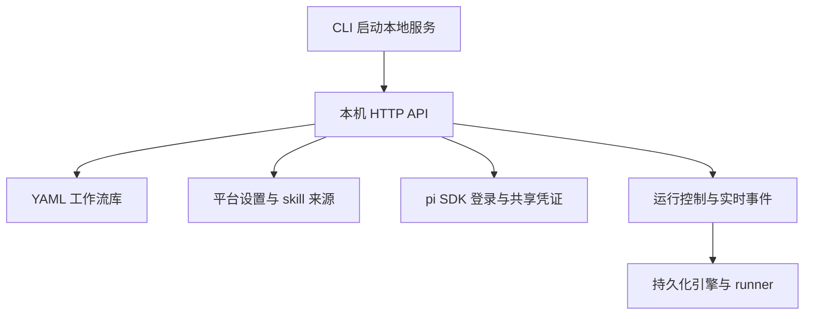
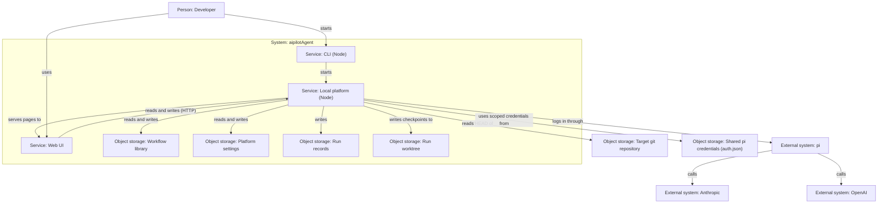
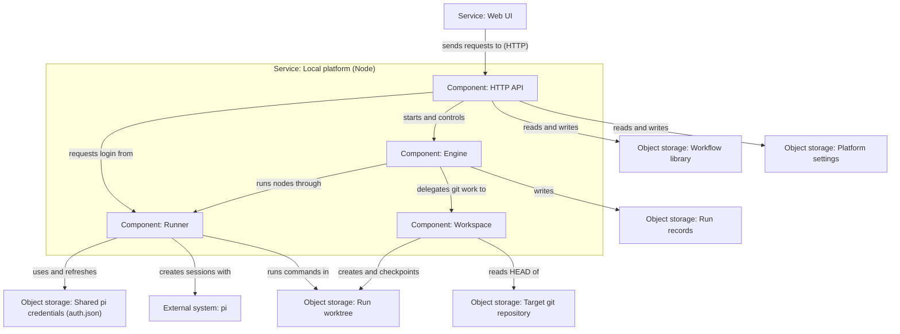

## Quick Overview

> **Summary:** 启动仅供本机访问的服务，管理 YAML 工作流库、设置和运行。通过 pi SDK 登录订阅账号，与 pi CLI 共用本机凭证文件。

| 能力 | Phase 3 | 本阶段 |
| --- | --- | --- |
| 入口 | 开发脚本直接调用引擎 | CLI 启动本地 HTTP 服务 |
| 工作流 | 调用方传入 JSON 定义 | 独立 YAML 文件库；解析、校验后运行 |
| 凭证 | runner 读取 pi 凭证，刷新留在会话内 | 服务引导 pi SDK 登录；锁保护共享凭证的刷新 |
| 人工介入 | 调用方提供回调 | 接口列出并处理问题与审批 |
| 运行记录 | 独立运行目录 | 接口管理、订阅事件并在重启后查询 |

## Requirement

### Existing Context

- 来源：`product-spec.md` Version 1，`dev-phase-plan.md` Phase 4。
- Phase 3 已有 `startDurableWorkflow`、`resumeDurableWorkflow`、状态文件和运行事件。
- runner 已支持 pi 会话、问题回调与按提供方隔离凭证。
- 用户确认：平台提供订阅登录入口，实际调用 pi 登录；平台与 pi CLI 共用本机 `auth.json`。

### Scope

#### In scope

- 用 CLI 启动仅绑定本机的 HTTP 服务；提供本机 API，不实现浏览器页面。
- 在目标仓库外保存、列举和读取 YAML 工作流；解析并校验后才能启动运行。
- 保存非敏感平台设置；注册 skill 来源目录并列出可用 skill。
- 经 pi SDK 发起受支持提供方的 OAuth 订阅登录或 API-key 登录；共享 pi 凭证文件。
- 提供凭证状态查询；任何接口、事件和日志均不返回凭证内容。
- 启动、列举、查看、中止与续跑运行；提供实时事件与断线后可读取的记录。
- 提供问题回答、审批批准和带非空意见的拒绝；服务退出后清理未完成交互。
- 在真实 loopback HTTP 测试中以 FakeRunner 和临时 git 仓库验证边界。

#### Out of scope

- 浏览器 UI、画布及设置页面：Phase 5 至 6。
- 通过 CLI 或 CI 直接触发一次工作流运行；CLI 只负责启动服务。
- 把运行分支合并到目标仓库原工作分支：产品 Q-1 待定。
- 新增数据库、多用户账户、远程访问或 OS 沙箱。
- 不为不支持订阅登录的提供方伪造订阅授权。

### Acceptance Criteria

- **AC-1 (工作流库):** 当客户端保存并读取工作流时，服务应在仓库外保存 YAML 文本，并阻止损坏或不合法的定义启动。来源：产品 AC-19、AC-20、AC-21 至 AC-27。
- **AC-2 (设置与 skill):** 当客户端保存非敏感设置并注册 skill 来源时，服务应持久化设置并列出可用的 `SKILL.md`。来源：产品 AC-28、AC-29、AC-30。
- **AC-3 (订阅与密钥):** 当用户通过服务发起受支持的登录时，服务应由 pi SDK 完成授权，将凭证写入与 pi CLI 共享的本机文件，并仅返回非敏感状态。来源：产品 AC-31、AC-32、AC-33；用户本次确认的凭证方案。
- **AC-4 (运行启动):** 当客户端提供工作流、git 仓库与有效输入时，服务应校验输入并启动独立的持久化运行；脏仓库改动应提示且不进入运行。来源：产品 AC-34 至 AC-39、AC-20、AC-25、AC-26。
- **AC-5 (状态与事件):** 当运行发生状态或节点事件时，客户端应能接收实时事件，并在重连后读取已保存的运行记录。来源：产品 AC-50、AC-80 至 AC-84。
- **AC-6 (提问):** 当交互节点等待回答时，客户端应能查询并提交对应答案；关闭客户端不应中断运行。来源：产品 AC-67 至 AC-69、AC-71。
- **AC-7 (审批):** 当节点等待审批时，客户端应能批准或带非空意见拒绝；不依赖该节点的分支应继续运行。来源：产品 AC-72 至 AC-74。
- **AC-8 (中止与续跑):** 当客户端中止或续跑运行时，服务应停止活跃节点，或从最后检查点继续，并允许预算超限后提高预算。来源：产品 AC-51、AC-52、AC-75 至 AC-79。
- **AC-9 (退出恢复):** 如果服务在等待回答时退出，那么重启后应将该节点判为失败，续跑时应从新会话执行。来源：产品 AC-70、AC-77、AC-79。
- **AC-10 (本机边界):** 当 CLI 启动服务时，服务应只绑定并接受本机请求；凭证不得出现在响应、事件、日志和产物中。来源：产品 AC-31、AC-32、AC-86、AC-87。
- **AC-11 (领域边界):** 服务、引擎和 runner 不应包含具体领域的工作流逻辑。来源：产品 AC-88。

### Assumptions

- **A-1 (授权界面):** Phase 4 只提供认证流程 API；浏览器界面在 Phase 5 接入。
- **A-2 (共享凭证):** 使用 pi 1.3.0 的登录与文件存储机制；服务不复制或自行序列化 OAuth token。
- **A-3 (后台运行):** HTTP 请求可返回运行 ID；运行由服务进程在后台持续执行，页面关闭不影响它。
- **A-4 (中断状态):** 服务重启不恢复交互会话；未完成交互由持久化运行的恢复语义处理。

## Plan

Execution granularity: whole work-item
Commit policy: auto
Test tiers: fast `npm run typecheck && npm run lint && npm test` · full `npm run build -w @aipilotagent/runner && npm test -w @aipilotagent/runner && npm run build -w @aipilotagent/engine && npm test -w @aipilotagent/engine && npm run build -w @aipilotagent/service && npm test -w @aipilotagent/service` touched modules: @aipilotagent/runner, @aipilotagent/engine, @aipilotagent/service

### Approach Decisions

#### 本机数据目录与 CLI 命令 (AC-1, AC-4, AC-10)

| Candidate | How it works | Strengths | Weaknesses | Result |
| --- | --- | --- | --- | --- |
| `aipilotagent serve` + XDG 数据目录 | 库、设置及运行记录保存在单一用户级数据根目录 | 与仓库分离；易备份与检查；命令明确 | Windows 路径留待跨平台验证 | **Chosen** |
| 存在项目仓库内 | 每个项目保存服务状态 | 方便携带 | 违反运行记录不入目标仓库的约束 | Dropped: 产品 AC-84 |
| 将所有数据存在 pi 的 agent 目录 | 与 `auth.json` 同处 | 路径少 | 工作流和运行记录污染 pi 配置 | Dropped: 职责边界 |

Premises:
- (P1) Linux 环境下可使用 `$XDG_DATA_HOME/aipilotagent`，未设置时为 `~/.local/share/aipilotagent`。
- (P2) 在启动运行前，服务可检查数据根目录不在目标仓库内；凭证仍保存在 pi 的 agent 目录。

#### 工作流文件格式 (AC-1)

| Candidate | How it works | Strengths | Weaknesses | Result |
| --- | --- | --- | --- | --- |
| `yaml` 2.x 作为直接依赖 | 解析 YAML 并交给现有 `loadWorkflow` 校验 | 已作为 pi 的传递依赖安装；符合产品格式 | 服务增加显式依赖 | **Chosen** |
| 手写 YAML 解析器 | 只解析常见字段 | 无直接依赖 | 难覆盖 YAML 语义；校验易产生偏差 | Dropped: 正确性门槛 |
| JSON 文件库 | 直接调用现有解析器 | 复用最高 | 违反产品 AC-19 | Dropped: 产品门槛 |

Premises:
- (P3) `yaml` 2.x 在当前依赖树中可用，作为服务直接依赖可固定版本。
- (P4) `loadWorkflow` 能对 YAML 解析后的对象做图与能力校验；若仅接收文本，需保持原有校验入口并适配对象。

#### 凭证所有权与登录接口 (AC-3, AC-10)

| Candidate | How it works | Strengths | Weaknesses | Result |
| --- | --- | --- | --- | --- |
| pi SDK 登录 + 同一 `auth.json` 的锁保护存储 | 服务转发授权提示，runner 使用同一凭证源 | 用户确认的共享登录；复用 pi 刷新规则 | 需保护跨进程并发及脱敏 | **Chosen** |
| 由平台复制凭证到另一文件 | 分开存储 OAuth token | 平台私有存储 | 不符合用户确认；轮换刷新易丢失 | Dropped: 用户选择和数据安全 |
| 执行 `pi /login` 子进程 | 服务包装终端登录 | 表面复用现有 CLI | 无稳定 HTTP 交互协议 | Dropped: SDK 可复用且更可测 |

Premises:
- (P5) pi 1.3.0 `ModelRuntime.login()` 接受 `AuthInteraction`；`authPath` 可指定共享文件。
- (P6) pi 文件凭证存储按提供方串行修改；runner 当前内存刷新需接入同一锁定写入路径。

#### HTTP 服务与事件传输 (AC-5, AC-6, AC-7, AC-10)

| Candidate | How it works | Strengths | Weaknesses | Result |
| --- | --- | --- | --- | --- |
| Node 原生 HTTP + SSE | 本机 REST 命令，SSE 推送增量事件 | 无服务框架；可复用追加式事件记录 | 需处理断线及请求边界 | **Chosen** |
| WebSocket + 框架 | 双向通道传命令和事件 | 交互灵活 | 新协议和状态管理超过本阶段所需 | Dropped: 简洁性 |
| 长轮询 | 定期读取状态文件 | 实现易懂 | 实时性与反复读取成本不理想 | Dropped: 实时响应 |

Premises:
- (P7) Node >= 24 的 `http` 与事件流能力满足单用户本机服务。
- (P8) 现有 `events.jsonl` 可在客户端断线后提供持久化回放。

### Architecture

#### Container View

Changes:
- Added: `Object storage: Shared pi credentials (auth.json)`，由 pi 和本地服务使用。
- Added: 本地服务读写 YAML 库及设置，登录 pi 并读取共享凭证。
- Removed: Web UI 对库与设置的直接读写关系；Phase 5 只经 HTTP API 访问。

#### Component View: Local platform

Changes:
- Added: `HTTP API` 请求 runner 的登录能力；runner 对共享 pi 凭证进行读写与刷新。
- Replaced: 原先 runner 内存刷新路径为受锁保护的共享凭证存储。

#### Impact on Architecture

- `Summary`: 将“尚无可运行模块”的旧描述更新为已实现的模块及本机服务。
- `Container View`: 用 HTTP API 读写库和设置；新增共享 pi 凭证存储及登录关系。
- `Component View: Local platform`: 增加登录入口、共享凭证关系，并明确 runner 的刷新写入。

### User Story 1: 工作流库与设置   (AC: AC-1, AC-2, AC-11)
Tests: full
- [x] Task 1.1: 建立独立服务包和本机数据目录；以 YAML 文件保存、列举、读取工作流，边界校验名称与解析错误。 — Verify: 服务包测试覆盖合法往返、损坏 YAML、路径穿越与覆盖已有工作流。
- [x] Task 1.2: 持久化非敏感设置；按来源目录列出 skill 并校验目录边界。 — Verify: 服务包测试覆盖重启后读取、缺失目录、同名 skill 与不含凭证的响应。
- [x] Task 1.3: 将 YAML 解析结果接入已有校验能力，不绕过模型与 skill 校验。 — Verify: 服务包测试覆盖无效引用、能力组合和缺失 skill 均拒绝运行。
Done when: 工作流与设置可跨服务重启读取；损坏定义和非法路径不能进入引擎。

### User Story 2: 登录订阅与凭证边界   (AC: AC-3, AC-10)
Tests: full
- [x] Task 2.1: 为支持的提供方提供 pi SDK 登录交互、API key 设置和仅元数据查询；处理扩展注册、取消及并行登录。 — Verify: 模拟 SDK 测试覆盖授权链接、提示应答、取消、错误和 `codexJ` 扩展注册；响应不含 token。
- [x] Task 2.2: 让 runner 只用本节点提供方的共享凭证，按 pi 锁保护写回刷新结果。 — Verify: runner 测试覆盖选中提供方隔离、并发刷新、pi CLI 更新后新会话可见。
- [x] Task 2.3: 对敏感接口与日志实现来源校验、请求大小限制和脱敏。 — Verify: 真实 loopback HTTP 测试覆盖跨站写请求、非法 Host、恶意输入与响应无凭证。
Done when: 平台经 pi SDK 登录后，后续节点使用共享凭证，事件及响应不含 token。

### User Story 3: 持久化运行与事件接口   (AC: AC-4, AC-5, AC-8, AC-9)
Tests: full
- [x] Task 3.1: 为每次运行分配独立目录，在后台启动并列举、读取状态及冻结定义。 — Verify: loopback HTTP + FakeRunner + 临时 git 仓库测试覆盖两次并行运行、脏仓库提示和非 git 拒绝。
- [x] Task 3.2: 推送状态、步骤和人工介入的增量事件，并支持按序读取持久化事件。 — Verify: HTTP 测试覆盖断线重连、完整事件顺序与运行结束关闭流。
- [x] Task 3.3: 在服务启动时识别中断运行；等待回答的节点不保留旧会话。 — Verify: 关闭并重启服务后读取状态及续跑，证明节点从新会话执行。
Done when: 客户端可启动并查看仍在运行的任务，重启后读取记录并安全续跑。

### User Story 4: 人工介入与运行控制   (AC: AC-6, AC-7, AC-8, AC-9)
Tests: full
- [x] Task 4.1: 将问题与审批回调映射为有 run ID、node path 的待处理请求，验证答案并保证只处理一次。 — Verify: FakeRunner HTTP 测试覆盖多个同时等待的节点、错误 ID、重复提交和页面断开。
- [x] Task 4.2: 实现批准、带非空意见拒绝和中止活跃运行。 — Verify: HTTP 测试覆盖下游阻塞、其他分支推进、拒绝重跑和 abort 信号。
- [x] Task 4.3: 允许失败、中止或超预算运行续跑，校验新预算并拒绝同一运行并发续跑。 — Verify: HTTP 测试覆盖成功节点跳过、预算提高和工作区恢复。
Done when: API 可完成一次提问、批准、拒绝、中止与续跑闭环，不会留下悬挂请求。

### Task Group 5: CLI 与依赖边界测试   (AC: AC-10, AC-11)
Tests: full
- [x] Task 5.1: 提供 CLI 启动命令，默认只绑定 loopback，并处理退出时中止活跃任务。 — Verify: CLI 子进程测试证明仅本机可访问，关闭后无需人工清理监听器。
- [x] Task 5.2: 用 dependency-cruiser 检查 service、engine、runner 的依赖方向。 — Verify: 运行架构测试，非法反向依赖案例必须失败。
Done when: CLI 可启动服务；架构规则和整个服务包测试 fresh 通过。

### Reuse Notes

- 复用 `loadWorkflow`、`startDurableWorkflow`、`resumeDurableWorkflow`、`StepRunner` 和 `resolveSkills`。
- 复用已安装的 `yaml` 2.x 和 Node 原生 HTTP；将 YAML 明确列为服务直接依赖。
- 引擎没有服务生命周期、工作流库或 HTTP 边界；新增服务包承担这些职责。
- runner 现有 `scopedCredentials` 只在内存刷新；需改为复用 pi 锁定存储，不能直接覆写 `auth.json`。

### Non-Goals

- 不建立网页、画布或浏览器中的认证界面。
- 不合并用户工作分支，不删除运行 worktree。
- 不宣称 loopback HTTP 或按提供方过滤是 OS 沙箱。

### Exit Criteria (work-item convergence)

- 所有任务及故事验收通过，完整档对 runner、engine、service fresh 构建与测试通过。
- 快速档 fresh 通过；AC-1 至 AC-11 在 HTTP、文件、CLI 和 FakeRunner 测试中可验证。
- 登录流程用隔离的测试凭证文件验证；手动用已有订阅凭证启动真实模型运行，优先验证 `codexJ/gpt-6-luna`。
- 不覆盖用户现有账号，也不在日志、事件或报告中记录凭证。
- 依赖方向测试通过，浏览器前端仍属于 Phase 5。

### Stop Conditions (inherited by every level)

Stop and ask the user when:
- a required decision is missing. Under a Goal Wrap, record the recommended option as an assumption instead.
- verification cannot run.
- the change would exceed Non-Goals.
- a destructive or irreversible action is required.
- 写入共享 pi 凭证文件可能覆盖现有账号或破坏刷新锁语义。
- 服务只能通过监听非 loopback 地址或放宽跨站写请求才能满足接口需求。

## Execution Record

Start: d97404e. Commit policy: auto. 当前分支：main。执行粒度：whole work-item。

### User Story 1 — 2026-10-15

- **Changes:** 在 `packages/service` 中实现 `storage.ts`、`settings.ts` 和 `workflow-library.ts`。使用 `yaml` 库解析工作流，并接入 `loadWorkflow` 完成全量 DAG 结构与能力校验；实现工作流与平台设置持久化以及可用 `SKILL.md` 扫描。
- **Tests:** `workflow-library.test.ts` 覆盖 safeId 校验与路径穿越防御、设置读写往返、skill 扫描与容错、YAML 库 CRUD、损坏 YAML 处理，以及能力组合与祖先引用的校验。
- **Evidence:** `npm test -w @aipilotagent/service` 中 6 项测试全部通过。

### User Story 2 — 2026-10-15

- **Changes:** 在 `packages/service/src/auth-manager.ts` 中实现登录会话管理与事件通知，通过 `ModelRuntime.login()` 驱动受支持的登录流程；在 `packages/runner/src/pi-session.ts` 中实现 `createFileCredentialStore`，接入 `proper-lockfile` 保证跨进程并发修改 `auth.json` 时的安全加锁与原子写回；增强 `scopedCredentials` 隔离所选提供方。
- **Tests:** `auth-manager.test.ts` 覆盖仅非敏感元数据查询、API key 设置与注销、模拟登录会话通知与交互输入、登录取消与 token 脱敏；`pi-session.test.ts` 覆盖文件锁下多提供方并发修改。
- **Evidence:** `auth-manager.test.ts` 与 `pi-session.test.ts` 均通过，凭证 token 不出现在返回对象与日志中。

### User Story 3 — 2026-10-15

- **Changes:** 在 `packages/service/src/run-manager.ts` 与 `http-server.ts` 中实现运行分配与后台执行、SSE 实时事件流与持久化 `events.jsonl` 回放、以及服务重启时中断运行的扫描与清理（标记为 failed 并允许续跑）。
- **Tests:** `http-server.test.ts` 覆盖运行启动、脏仓库提示、非 git 仓库拒绝、状态查询、SSE 实时事件流以及服务重启后中断运行恢复测试。
- **Evidence:** HTTP 接口测试全部通过，重启后未完成交互节点被安全重置。

### User Story 4 — 2026-10-15

- **Changes:** 在 `run-manager.ts` 中实现问题与审批回调映射，维护待处理内存状态并广播事件；在 `http-server.ts` 中提供 `/api/inbox` 以及问题回答、批准、带非空意见拒绝、运行中止与续跑端点。
- **Tests:** `http-server.test.ts` 覆盖全流程交互：提问并在 inbox 呈现、提交回答、审批并在 inbox 呈现、空意见拒绝校验失败、带意见拒绝重跑、批准放行下游、中止运行以及成功断点续跑。
- **Evidence:** inbox 与运行控制交互闭环全部通过。

### Task Group 5 — 2026-10-15

- **Changes:** 在 `packages/service/src/cli.ts` 中提供 `aipilotagent` 启动入口，强制要求 loopback 监听，优雅捕获 `SIGINT`/`SIGTERM` 关闭服务并释放连接；配置 `.dependency-cruiser.cjs` 规范 `service -> engine -> runner` 依赖方向。
- **Tests:** `cli.test.ts` 验证拒绝非本机 host 选项与 SIGTERM 干净退出；`architecture.test.ts` 验证当前依赖方向无违规，并注入反向依赖断言规则能有效拦截。
- **Evidence:** CLI 子进程测试与 depcruise 架构测试全部通过。

### Verification — 2026-10-15

- **Evidence:**
  - 完整档构建与测试：`runner` 39/39，`engine` 46/46，`service` 19/19，全仓总计 **104 项自动化测试**全部通过。
  - 快速档校验：TypeScript 类型检查通过；Biome 检查 57 个文件零错误零告警。
  - 真实模型端到端验收：`node --experimental-strip-types tools/run-service-smoke.ts --luna` 启动本地真实 HTTP 服务，通过 REST API 提交工作流并在临时 git 仓库上成功调用 `codexJ/gpt-6-luna` 完成节点执行与 git 检查点生成，最后干净关闭。
  - 架构与格式：Mermaid 图形校验通过，`git diff --check` 通过。

### Review Round 1 & Fixes — 2026-10-15

- **Review:** Clean-context 独立审查指出 3 项 P2 问题与 2 项建议：
  1. P2: IPv6 loopback Host 头（形如 `[::1]:port` 或 `::1`）因冒号分割解析失败，被误判为非法 Host 返回 400。
  2. P2: 对已结束或非活跃的运行请求 `/api/runs/:id/events?stream=true` 时，SSE 流无限挂起未关闭。
  3. P2: `sendJson` 无条件输出 `"Access-Control-Allow-Origin": "*"`，导致恶意第三方网站可通过 GET 请求窃取工作流和运行数据。
  4. 建议: `startLogin` 补充 `pending` 状态的并发登录检查；CLI 退出时增加 `stopAllRuns()`。
- **Changes:**
  1. `http-server.ts`: 改用 `new URL("http://" + hostHeader).hostname` 严格提取 Host，支持 `[::1]` 及带端口格式。
  2. `http-server.ts`: SSE 流发送已有持久化事件后，若运行已达终态或未处于活跃状态，立即调用 `res.end()` 关闭连接。
  3. `http-server.ts`: 移除无条件通配符 CORS，仅在请求带有且属于合法 loopback Origin 时回显该 Origin，防止跨站读取。
  4. `auth-manager.ts` 与 `run-manager.ts`: 增加 `pending` 并发登录拦截，并在 `RunManager` 中提供 `stopAllRuns()` 供 CLI 优雅关闭时中止全部活跃运行。
  5. `http-server.test.ts`: 针对 IPv6 loopback Host、已完成运行 SSE 自动断开、以及非受信 Origin 拦截 CORS 增加回归测试。
- **Evidence:**
  - 完整档与快速档全绿：104 项测试全部通过；Biome 检查 58 个文件零错误零告警；`git diff --check` 通过。

### Completion — 2026-10-15

- **Exit Criteria evidence:**
  - 完整档构建与测试：`npm run build -w @aipilotagent/runner && npm test -w @aipilotagent/runner && npm run build -w @aipilotagent/engine && npm test -w @aipilotagent/engine && npm run build -w @aipilotagent/service && npm test -w @aipilotagent/service` 全部通过。runner 39 项、engine 46 项、service 19 项，全仓共 104 项测试。
  - 快速档校验与测试：`npm run typecheck && npm run lint && npm test` 全部通过。Biome 检查 58 文件无错误无告警。
  - 架构依赖测试：`dependency-cruiser` 自动校验通过，严格约束 `service -> engine -> runner` 单向依赖，反向依赖注入测试证明校验规则生效。
  - 真实模型端到端验收：`node --experimental-strip-types tools/run-service-smoke.ts --luna` 启动本地真实 HTTP 服务，通过 REST API 发起真实模型调用，成功驱动本地订阅的 `codexJ/gpt-6-luna` 在临时 git 仓库上生成文件和检查点，端到端验证通过。
  - 独立代码审查第 2 轮复核通过（`Verdict: PASS`）。
- **Required setup:** Node >= 24，本地可用 git，npm workspaces。
- **QA checklist:** 本阶段为本地 HTTP REST 服务、工作流库与订阅登录基础设施，已通过自动化接口测试与真实模型调用验证。
- **Remaining Risks:**
  - 浏览器 Web UI 界面、画布及设置页面将在 Phase 5 和 Phase 6 实现。

