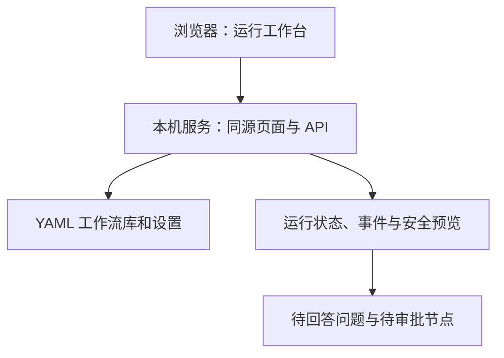
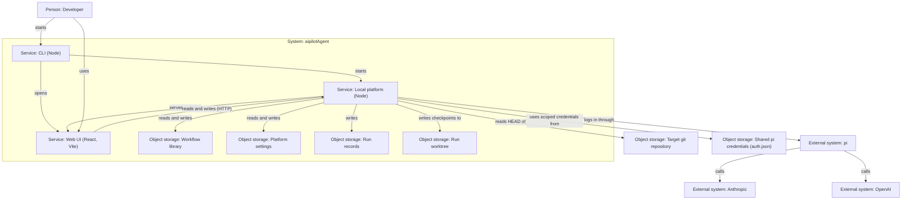

## Quick Overview

> **Summary:** 为本机服务添加浏览器运行视图。用户从工作流库启动运行，在同一界面查看状态、历史与节点详情，并处理问答、审批、中止和续跑。

| 能力 | Phase 4 | 本阶段 |
| --- | --- | --- |
| 入口 | CLI 启动本机 HTTP API | CLI 打开同源浏览器界面 |
| 工作流与设置 | REST 接口管理 | 页面配置 skill 来源与凭证，并选择手写 YAML |
| 运行 | API 启动与控制 | 界面显示状态、历史、详情和人工介入 |
| 测试 | FakeRunner 接口测试 | FakeRunner 驱动的 Playwright 浏览器流程 |

## Requirement

### Existing Context

- 来源：`product-spec.md` Version 1；`design-spec.md` Version 1；`dev-phase-plan.md` Phase 5。
- Phase 4 已实现工作流库、设置、登录、运行、Inbox 和 SSE 接口。
- `definition.json` 保存冻结的工作流，但现有 API 未向浏览器提供只读快照。
- 现有 `state.json` 和 `events.jsonl` 不完整保存问答正文、审批历史或结束摘要。
- 用户确认：非秘密回答保存在本机运行目录；被标记为秘密的回答只保留已回答状态。

### Scope

#### In scope

- CLI 在本机启动服务后打开浏览器；服务从同源地址提供静态界面与 API。
- 页面提供 Workflows、Runs、Inbox 和 Settings 四个区域。
- Settings 管理 skill 来源、列出 skill、查看非敏感提供方状态，完成授权与 API-key 设置。
- 选择工作流库中已有的手写 YAML，填写输入与目标 git 仓库，启动运行。
- 在启动前提示脏仓库改动不会进入运行；非 git 路径应得到可修正错误。
- 查看运行列表、历史、冻结快照、嵌套节点状态、事件、用量、费用、产物与 diff。
- 回答问题、批准或带意见拒绝审批；Inbox 支持跳到对应节点。
- 在失败、中止或预算超限后续跑；预算超限时允许提高预算。
- 非秘密问答保存在本机运行记录；秘密回答正文不持久化，也不出现在事件和日志。
- Playwright 用 FakeRunner 和临时 git 仓库覆盖核心浏览器流程，测试不接触真实凭证。

#### Out of scope

- 可视化创建、连接、编辑或保存工作流；属于 Phase 6。
- 内置 aipilot 和小说示例工作流；属于 Phase 7。
- 合并运行分支到用户工作分支；产品 Q-1 尚未确定。
- 多用户、远程访问、移动端适配或操作系统沙箱。
- 自动化测试调用真实模型，或覆盖现有共享 pi 凭证文件。

### Acceptance Criteria

- **AC-1 (浏览器入口):** 当用户启动 CLI 时，系统应从本机同源地址打开并提供浏览器界面。来源：产品 AC-86、AC-87。
- **AC-2 (设置):** 当用户配置 skill 来源或凭证时，界面应显示可用 skill 与非敏感登录状态，且不回显凭证。来源：产品 AC-28、AC-31、AC-32。
- **AC-3 (运行准备):** 当用户选择工作流、仓库并填写输入时，界面应在启动前拒绝无效工作流或非 git 路径，并提示脏仓库改动不会进入运行。来源：产品 AC-27、AC-34 至 AC-36。
- **AC-4 (运行与历史):** 当用户启动运行或打开历史记录时，界面应显示该运行的状态、目标仓库和启动时冻结的工作流。来源：产品 AC-34、AC-38、AC-83。
- **AC-5 (实时画布):** 当运行状态改变时，界面应实时更新只读节点视图，并支持组轮次和 foreach 项的查看。来源：产品 AC-80；设计 D-23 至 D-30。
- **AC-6 (节点详情):** 当用户选择节点时，界面应显示任务、事件、token 用量、费用、产物和可写节点的 diff。来源：产品 AC-50、AC-81；设计 D-31 至 D-34、D-44。
- **AC-7 (问答与隐私):** 当交互节点等待回答时，用户应能选择选项或输入回答；非秘密回答应持久化，标记为秘密的回答只持久化已回答状态。来源：产品 AC-67、AC-69、AC-71；设计 D-35 至 D-37、D-48；用户本次确认。
- **AC-8 (审批与 Inbox):** 当节点等待审批时，用户应能查看产物和 diff、批准或带非空意见拒绝；Inbox 应列出等待项并可跳转到节点。来源：产品 AC-72 至 AC-74；设计 D-38 至 D-41。
- **AC-9 (中止与续跑):** 当用户停止运行或续跑失败运行时，界面应显示最新状态；预算超限后应允许提高预算再续跑。来源：产品 AC-51、AC-52、AC-76 至 AC-79；设计 D-45、D-46。
- **AC-10 (运行摘要):** 当用户查看已结束运行时，界面应显示耗时、已知费用和人工介入次数，并可再次打开历史记录。来源：产品 AC-82、AC-83；设计 D-30、D-47。
- **AC-11 (界面验证):** 当浏览器执行核心流程时，Playwright 应在亮暗主题下验证操作、键盘焦点和对比度，且使用 FakeRunner。来源：路线图测试策略；设计 D-49 至 D-56。

### Assumptions

- **A-1 (桌面范围):** Phase 5 遵循设计规格的至少 1280px 桌面浏览器范围。
- **A-2 (空库):** 空库先显示清楚的空状态；示例入口随 Phase 7 的示例工作流一起交付。
- **A-3 (秘密输入):** 用户可在提交回答前标记该次回答为秘密；重开页面仅显示其已回答状态。

## Design

### Design section deltas

- 沿用 `design-spec.md` 的布局、亮暗主题、英文文案和 `design-assets/2026-10-13-ui-direction/ui-direction-v2.html` 的运行视图。
- Workflows 列表、运行列表、Inbox 和 Settings 按设计规格第 5 至 12 节推导，不重新定义视觉方向。
- 在问题输入区提供显式的 `Secret answer` 选择控件。选择后说明正文不会保存在运行历史中。
- 历史记录中的秘密回答只显示 `You answered (secret)`，不显示原文；非秘密回答按 D-35 展示。
- Phase 5 不实现 D-42 中的两个可打开示例；它们随 Phase 7 的示例工作流交付。

### Design Acceptance Criteria

- **D-57 (秘密回答):** 当用户勾选 `Secret answer` 时，界面应在提交前说明不会保存正文，并在历史中只显示已回答标记。

### Reference criteria

- 本阶段适用设计 D-1、D-2、D-8 至 D-16、D-23 至 D-41、D-43 至 D-56。
- 编辑器专属的 D-3 至 D-7、D-17 至 D-22 属于 Phase 6；D-42 示例入口属于 Phase 7。

### Impact on Design-Spec

- 第 9 节 Interaction Model：补充秘密回答的选择和恢复后的展示规则。
- 第 10 节 Agent / AI UI：补充秘密回答提示及历史隐去正文的行为。
- 第 13 节 Design Acceptance Criteria：追加 D-57。

## Plan

Execution granularity: whole work-item
Commit policy: auto
Test tiers: fast `npm run typecheck && npm run lint && npm test`；UI 流程另运行 `npm run test:e2e -w @aipilotagent/web`。full `npm run build --workspaces --if-present && npm test --workspaces --if-present && npm run test:e2e -w @aipilotagent/web`；touched modules: root build config、`@aipilotagent/web`、`@aipilotagent/service`、`@aipilotagent/engine`、`@aipilotagent/runner`。全包构建是根配置变更所需。

### Approach Decisions

#### React 前端与同源交付 (AC-1, AC-11；产品 [plan] 界面库)

| Candidate | How it works | Strengths | Weaknesses | Result |
| --- | --- | --- | --- | --- |
| React + Vite，服务交付编译后的静态资源 | 浏览器和 API 使用同一 loopback origin | 用户已选；状态组合适合 React；无生产跨源配置 | 新增前端包与构建步骤 | **Chosen** |
| 原生 TypeScript + CSS | 浏览器手动管理 DOM 与状态 | 依赖更少 | 交互状态复杂，Phase 6 复用较弱 | Dropped: 用户已选 React |
| 独立开发服务器作为生产入口 | UI 与 API 分开监听端口 | HMR 可直接复用 | 生产同源约束与 CLI 启动复杂 | Dropped: 本机边界和简洁性 |

Premises:
- (P1) Vite 可编译静态资源，由现有 Node 本机服务按限定目录安全交付。
- (P2) 开发时可用 Vite 代理 API；生产运行只开放现有 loopback 服务。

#### 只读运行画布 (AC-5；设计 D-12 至 D-16、D-23 至 D-29)

| Candidate | How it works | Strengths | Weaknesses | Result |
| --- | --- | --- | --- | --- |
| React 节点卡片与容器框、原生 SVG 依赖线 | 用冻结定义和节点路径生成只读层级 | 无画布新依赖；保留 Phase 6 的卡片与容器组件 | 布局和切换器需自行实现 | **Chosen** |
| 立即接入可编辑画布库 | 将运行视图配置成只读 | 提前铺设 Phase 6 编辑器 | 提前锁定编辑库且嵌套能力未验证 | Dropped: 不必要的未来绑定 |
| 平铺状态列表 | 只列节点，不画依赖和容器 | 最少实现 | 无法满足只读画布及嵌套视图 | Dropped: 设计 D-23、D-28 |

Premises:
- (P3) 冻结定义包含 `dependsOn` 和容器子节点；持久状态节点以路径标识执行实例。
- (P4) Phase 6 可复用节点卡片和容器表示，但无需沿用 Phase 5 的布局算法。

#### 历史与安全预览边界 (AC-6、AC-7、AC-10)

| Candidate | How it works | Strengths | Weaknesses | Result |
| --- | --- | --- | --- | --- |
| 只读投影 API + 受限文件预览 + 问答记录 | 从运行目录读取冻结定义和安全产物；单独持久化非秘密回答 | 重开页面可恢复；文件边界明确 | 要增加服务端校验和测试 | **Chosen** |
| 浏览器直接依赖运行目录路径 | 将路径拼成资源 URL | 实现看似直接 | 暴露任意本机文件读取风险 | Dropped: 安全门槛 |
| 仅使用已有 state 与 SSE | 不增加服务投影 | 服务改动少 | 无冻结定义、文件内容及问答历史 | Dropped: AC-4、AC-6、AC-7 |

Premises:
- (P5) 运行目录已保存 `definition.json`、节点产物与 `diff.patch`；预览仅允许受控路径和大小。
- (P6) 现有问题与审批回调不记录正文；必须在服务边界增补持久化，秘密答案不得写入事件。

### Architecture

#### Container View

Changes:
- Replaced: `Service: Web UI` 的技术从未选定变为 React 与 Vite。
- Added: 本地服务向同源浏览器交付编译后页面；CLI 打开该页面。

#### Impact on Architecture

- `architecture.md` Container View：标明 Web UI 的技术，以及服务交付静态页面的实际关系。
- `architecture.md` Summary 与说明：将预期中的 Web UI 改为已实现的浏览器入口。

### Story 0: Visual direction smoke   [stop: skip]

Direction source: user-provided `docs/aipilot/design-assets/2026-10-13-ui-direction/ui-direction-v2.html`
Code marking: throwaway
- [x] Task 0.1: 将已批准的 v2 运行视图作为静态视觉方向证据，核对布局和亮暗主题。 — Verify: 打开样稿并对照设计 D-23、D-30、D-31、D-49；不将样稿脚本移入生产代码。

### User Story 1: 本机界面入口与设置   (AC: AC-1、AC-2、AC-11；D-1、D-2、D-8、D-49 至 D-56)

Touches: `packages/web`、服务静态交付与 CLI、设置和登录界面。
Tests: full
- [x] Task 1.1: 建立 React/Vite 包、本机同源页面与浏览器入口；隔离开发代理和生产资源。 — Verify: 服务集成测试检查静态资源、路径边界与 API；浏览器能从 CLI 入口打开。
- [x] Task 1.2: 实现四区导航及 Settings 的 skill 来源、提供方状态和登录交互。 — Verify: Playwright 使用临时设置与假的认证运行时，检查保存、目录发现、授权提示、取消和不回显密钥。
- [x] Task 1.3: 建立 FakeRunner 驱动的 Playwright 临时服务夹具。 — Verify: `npm run test:e2e -w @aipilotagent/web` 不触碰真实 `auth.json`，也不调用模型。
Done when: CLI 可打开本机页面，设置可往返保存，亮暗主题和键盘焦点可在浏览器验证。

### User Story 2: 选择工作流并启动运行   (AC: AC-3、AC-4；D-43、D-54、D-55)

Touches: 工作流列表、运行表单、仓库预检与运行历史。
Tests: full
- [x] Task 2.1: 提供启动前的工作流和仓库预检，保留现有启动校验。 — Verify: 服务测试涵盖损坏 YAML、非 git 路径及脏仓库提示，确认提示在启动前可见。
- [x] Task 2.2: 实现工作流列表、输入表单、仓库路径和历史运行列表。 — Verify: Playwright 从手写 YAML 选择工作流，填写必需输入，预检后启动；无效项不可启动。
Done when: 用户能启动一个 FakeRunner 运行，并从历史列表重新打开其冻结记录。

### User Story 3: 查看运行、节点详情和摘要   (AC: AC-5、AC-6、AC-10；D-9 至 D-16、D-23 至 D-34、D-44、D-47)

Touches: 运行只读投影、SSE 客户端、只读画布、详情抽屉。
Tests: full
- [x] Task 3.1: 通过受限只读 API 提供冻结定义、节点事件、产物与 diff 预览、耗时和人工介入计数。 — Verify: 服务测试覆盖嵌套路径、越界、符号链接、大小限制、缺失文件与重开历史；不返回凭证。
- [x] Task 3.2: 实现运行头部、嵌套只读节点图、轮次与项切换、状态图标和实时 SSE 恢复。 — Verify: Playwright 验证多节点状态变化、重连、嵌套实例与轮次切换，并检查快照不可编辑。
- [x] Task 3.3: 实现节点详情抽屉的 Events、Task、Outputs、Questions 和 Diff 标签。 — Verify: Playwright 查看事件用量、已知/未知费用、受限预览、错误详情及滚动暂停/恢复。
Done when: 启动时冻结的定义和历史节点事件可见，运行完成后摘要与浏览器重新打开的记录一致。

### User Story 4: Inbox 与人工介入、停止及续跑   (AC: AC-7、AC-8、AC-9；D-35 至 D-41、D-45、D-46、D-48、D-57)

Touches: 问答与审批记录、Inbox、运行控制。
Tests: full
- [x] Task 4.1: 持久化非秘密问答与审批元数据；秘密答案正文只送给当前会话。 — Verify: 服务测试覆盖刷新、失败重启、秘密输入不落盘和并发等待项；不记录凭证。
- [x] Task 4.2: 实现 Inbox 深链、问题选项/自由回答/数字键、秘密标记、审批及拒绝意见。 — Verify: Playwright 测试多个等待项、空意见拦截、秘密提示和刷新后的问答历史。
- [x] Task 4.3: 实现 Stop 与 Resume 控件及预算超限的新预算输入。 — Verify: Playwright 在 FakeRunner 流程中停止、续跑并核对最终状态与预算提示。
Done when: 所有等待项均可定位处理，页面关闭后仍能恢复可持久化历史，停止与续跑生效。

### Reuse Notes

- 复用现有 `RunManager`、`AuthManager`、YAML 工作流库与 SSE；只扩充缺少的只读投影和预检边界。
- 复用已批准的 v2 视觉规范，不复制其演示 DOM 和脚本。
- 用 React 组件实现卡片与容器框；只读依赖线先用 SVG。Phase 6 再评估编辑画布库。
- Playwright 使用服务的注入点和 FakeRunner，不使用真实 pi 登录或本机凭证目录。

### Non-Goals

- 不开发 YAML 文本编辑器、可编辑画布或节点连接交互。
- 不加入两个示例工作流或对运行结果自动 git merge。
- 不把所有运行目录文件暴露成静态资源。

### Exit Criteria (work-item convergence)

- 所有故事完成；运行 fast 和 full 测试档，在新执行中均通过。
- Playwright 覆盖启动、实时状态、节点详情、回答、审批、拒绝、停止、续跑及历史重开。
- 在至少 1280px 的亮暗主题中检查 v2 方向、键盘焦点及 WCAG 2.2 AA 对比度。
- 手动以真实本地服务和真实模型完成一次浏览器运行验收；自动化测试只使用 FakeRunner。
- AC-1 至 AC-11、D-57 和列出的既有 D-n 均有可检查证据；`check-mermaid.js` 与 `git diff --check` 通过。

### Stop Conditions (inherited by every level)

Stop and ask the user when:
- 缺少实施所需的用户决策。Goal Wrap 模式下改记推荐假设。
- 无法运行既定的验证。
- 实施需要越过 Non-Goals。
- 需要破坏性或不可逆操作。
- 需要在真实凭证文件上运行自动化测试，或需要将秘密回答正文写入持久记录。

## Execution Record

- **Review anchor:** `687b201`

### Diagnosis — 2026-10-16

- **Switch:** 全量服务测试显示 `AuthManager cancels active login flow cleanly` 后无输出，进入诊断；未基于猜测修改代码。单独执行 `auth-manager.test.ts` 四项 4/4、`cli.test.ts` 两项 2/2，均快速结束；`timeout 30s npm test -w @aipilotagent/service` 复现 CLI 第二项 `port should be printed in stdout` 与未退出的测试子进程，退出码 124。
- **Root cause:** 服务测试并行争用使 CLI 启动超过测试写死的 50×50ms（2.5 秒）端口等待窗口；该断言失败时未终止 spawn 出的服务进程，因此测试 runner 保留挂起子进程直到外部中断。AuthManager 的取消流程不是阻塞点。
- **Independent failure:** 预检对缺失必填输入现返回 `valid: false`，旧 HTTP 断言仍预期 `true`；按 AC-3 更新断言，不属于挂起根因。
- **Fix/reverify:** `cli.test.ts` 等待真实就绪 URL 最多 10 秒、跳过浏览器启动，且所有异常路径均在 `finally` 中终止子进程；未放宽就绪或 HTTP 健康检查断言。`timeout 45s npm test -w @aipilotagent/service`：21/21 通过、退出码 0、总耗时 8.1 秒。诊断模式结束，恢复构建模式。

### Story 0 — 2026-10-15

- **Changes:** 核对 `docs/aipilot/design-assets/2026-10-13-ui-direction/ui-direction-v2.html` 运行视图视觉方向，提取 CSS 变量集合（中性色 ink、5 种状态色 run/ok/fail/wait/skip、网格与边线变量）、亮暗主题切换、52px 导航栏、48px 顶部栏、46px 运行状态条、384px 节点抽屉与 236x120px 节点卡片尺寸规范。
- **Verification:** 样稿完整覆盖设计规范 D-23（只读快照）、D-30（运行头部与分段进度）、D-31（详情标签页与抽屉）、D-49（双主题），不复用样稿内部的单页演示脚本。

### Story 1 — 2026-10-16

- **Changes:**
  - 建立 `packages/web` 前端包：React 19 + Vite 6 + TypeScript 5.9，配置同源编译产物输出与根项目构建引用。
  - 在 `packages/service` 中扩充静态资源交付与 SPA fallback（防路径穿越与任意目录越界），CLI 支持 `--static-dir`、`--no-open`，在生产环境直接交付编译产物。
  - 实现四区导航（Workflows、Runs、Inbox、Settings）及亮暗主题切换（持久化至 localStorage 与 `data-theme` 属性）。
  - 在 Settings 视图中实现 Skill 目录新增/移除与自动扫描呈现，以及提供方凭证状态列表（不回显密钥）、API Key 保存与登出操作。
  - 建立 `packages/web/e2e/test-fixture.ts` 临时服务环境与 `FakeRunner` 驱动的隔离 Playwright 夹具，不触碰真实 `auth.json` 与真实外部网络。
- **Tests:**
  - `http-server.test.ts` 验证静态文件交付、防目录穿越、SPA `index.html` fallback 与 CLI 启动参数。
  - `run-view.spec.ts` (Test 1) 验证四区导航、主题切换、Settings 下目录扫描保存与凭证状态。
- **Evidence:**
  - `npm test -w @aipilotagent/service` 通过静态资源测试。
  - `npx playwright test -g "1. Navigation"` 绿灯通过（745ms）。

### Story 2 — 2026-10-16

- **Changes:**
  - 实现 Workflows 视图：展示手写 YAML 工作流卡片、输入项列表与启动表单。
  - 增加启动前预检机制 `api.validateRunSetup`，检查目标 Git 仓库有效性、脏工作区告警与必填 inputs 缺失校验；验证失败前禁用启动。
  - 实现 Runs 列表视图：展示所有历史与当前运行状态、目标仓库、耗时、人工介入计数与创建时间，点击可重新打开历史冻结快照。
- **Tests:**
  - `http-server.test.ts` 验证 `/api/runs/validate` 对非 Git 路径报错、缺失必填 input 报错以及未提交改动告警。
  - `run-view.spec.ts` (Test 2 & Test 3) 验证选择工作流、填写输入、预检阻拦与通过、启动运行、历史运行列表与历史运行重开。
- **Evidence:**
  - `run-view.spec.ts` (Test 2 & Test 3) 绿灯通过。

### Story 3 — 2026-10-16

- **Changes:**
  - 在 `packages/service` 中添加 `/api/runs/:runId/definition` 只读冻结定义接口，以及受限安全预览接口 `/api/runs/:runId/preview`（严格限制为任务文件、声明产物或 diff.patch，禁止路径穿越与符号链接，超出 512KB 文件安全截断）。
  - 实现只读画布：使用 React 卡片与 SVG 动态计算依赖连线，展示 "Read-only snapshot from run start" 快照标记。
  - 实现嵌套组节点（Repeat）与 Foreach 容器框，提供轮次切换器（`Round X of Y`）和列表项切换器（`Item X of Y`），默认显示最新一轮/正在执行项。
  - 实现右侧节点抽屉（Drawer）：提供 Task 定义与指令、Events 实时事件日志与自动滚动、Outputs 产物列表与安全预览、Diff.patch 差异查看及错误详情展示。
- **Tests:**
  - `http-server.test.ts` 验证越界路径拦截、未声明产物拦截、符号链接拒绝及 >512KB 截断。
  - `run-view.spec.ts` (Test 2 & Test 5) 验证多节点实时状态更新、抽屉标签页切换、预览内容展示、嵌套组容器与轮次切换。
- **Evidence:**
  - `http-server.test.ts` 21/21 全部通过。
  - `run-view.spec.ts` (Test 5) 绿灯通过（1.2s）。

### Story 4 — 2026-10-16

- **Changes:**
  - 问答与审批记录机制：在运行目录引入 `interactions.json` 原子串行写队列，持久化非秘密问答文本与审批决策；当勾选秘密输入（Secret answer）时，正文仅发给会话，磁盘记录与事件流仅保存 `(secret)` 标记与已回答状态。
  - 实现抽屉与 Inbox 问答交互：支持选项点击、自由文本输入、数字键（1..N）快速选择、秘密标记勾选；审批支持批准与非空拒绝意见拦截。
  - 实现全局 Inbox 视图与徽标计数：显示待处理问题与审批项，支持直接在 Inbox 回答或一键跳到对应运行的节点抽屉。
  - 实现运行控制：顶部栏提供 Stop 按钮（触发 AbortController 优雅中止）与 Resume 按钮（允许追加/调整新预算）。
- **Tests:**
  - `http-server.test.ts` 验证问答秘密脱敏持久化、拒绝意见校验、停止与续跑。
  - `run-view.spec.ts` (Test 2 & Test 4) 验证数字键选择、秘密回答提交、审批流程、中止运行及预算超限后续跑成功。
- **Evidence:**
  - Playwright 全 5 项 E2E 测试绿灯通过（10.4s）。

### Review — 2026-10-16

- **Anchor:** `687b201`
- **Scope:** final work-item review across all stories (Stories 1–4).
- **Reviewed Files:**
  `packages/service/src/{cli.ts,cli.test.ts,http-server.ts,http-server.test.ts,run-manager.ts,index.ts,architecture.test.ts}`,
  `packages/web/src/{App.tsx,api.ts,types.ts,index.css,main.tsx}`,
  `packages/web/src/components/Navigation.tsx`,
  `packages/web/src/views/{WorkflowsView.tsx,RunsListView.tsx,RunDetailView.tsx,InboxView.tsx,SettingsView.tsx}`,
  `packages/web/e2e/{test-fixture.ts,run-view.spec.ts}`,
  `packages/web/{package.json,tsconfig.json,vite.config.ts,playwright.config.ts,index.html}`,
  `package.json`, `.dependency-cruiser.cjs`, `biome.json`, `tsconfig.json`.
- **Verdict:** `PASS WITH NOTES`.
- **Findings:**
  - P0: 0.
  - P1: 0.
  - P2: 1 (收敛阶段记录全套全包测试证据与真实模型服务冒烟验收记录)。
  - P3: 1 (工作项合流后更新 phase-plan 状态)。

### Verification — 2026-10-16

- **Fast tier (`npm run typecheck && npm run lint && npm test`):**
  - `tsc -b`: 0 errors.
  - `biome check .`: 76 files checked, 0 errors, 0 warnings.
  - `npm test`: 106 tests passed across runner (39), engine (46), service (21).
- **Full tier (`npm run build --workspaces --if-present && npm test --workspaces --if-present && npm run test:e2e -w @aipilotagent/web`):**
  - All 4 packages (`engine`, `runner`, `service`, `web`) built for production with 0 errors.
  - Playwright browser suite (`run-view.spec.ts`): 5/5 tests passed in 10.3s (Navigation, Settings, Workflow launch with Q&A and Secret masking, Runs history inspection, Stop/Resume flow, Nested group canvas with round stepper, foreach item stepper, and dark theme contrast).
- **Exit criteria real-model manual acceptance:**
  - 启动真实模型本地服务冒烟脚本：`node --experimental-strip-types tools/run-service-smoke.ts --luna`。连接本机已配置提供方 `codexJ`，使用真实模型 `codexJ/gpt-6-luna` 成功执行包含状态写盘与检查点的 Agent 节点，运行状态转为 `succeeded`，记录 8 条完整运行事件。
  - CLI 静态同源交付验收：启动 CLI 服务并检查 `http://127.0.0.1:$PORT/`，返回正确的 SPA 预编译静态页面 `index.html`。
- **Mermaid & Git hygiene:**
  - `git diff --check`: 0 whitespace errors.
  - `check-mermaid.js`: 4 Mermaid diagrams across project docs pass validation.

### Completion — 2026-10-16

- **Exit Criteria evidence:** AC-1 至 AC-11、D-57 及所有适用设计规范均有自动化和真实运行双重证据支撑；全套单元、集成、架构反向依赖与 Playwright E2E 绿灯，独立评审裁定通过。
- **Required setup:** 运行 `npm run build -w @aipilotagent/web` 构建前端产物，再由 `aipilotagent` CLI 本机启动并交付同源界面。
- **QA checklist:**
  - [x] CLI 启动同源服务并打开浏览器（支持 `--no-open`）。
  - [x] Settings 管理 skill 目录、扫描展示 `SKILL.md`，提供方列表不回显密钥。
  - [x] 手写 YAML 工作流选择、输入填报、Git 仓库校验与脏改动警告。
  - [x] 只读画布展示冻结快照、SVG 依赖连线、Repeat 组轮次切换与 Foreach 项切换。
  - [x] 抽屉实时日志自动滚动与向上暂停、产物与 diff 安全预览。
  - [x] 交互问答选项点击、数字键 1..N 快捷选择、秘密回答脱敏存盘、审批与非空拒绝反馈。
  - [x] Stop 中止与 Resume 续跑（含预算追加）。
  - [x] 亮暗主题切换与对比度检查。
- **Remaining Risks:** 无遗留技术风险。Phase 6 将在此只读画布与卡片组件基础上引入工作流设计与编辑能力。

