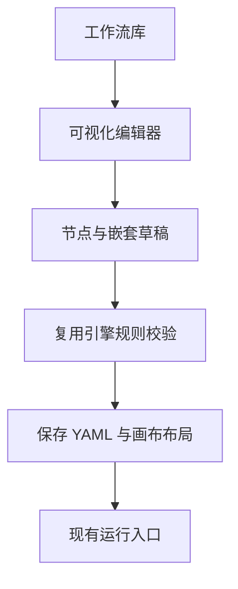

## Quick Overview

> **Summary:** 在 Phase 5 的本机 Web UI 中加入可视化工作流编辑器。开发者创建、连接、嵌套、配置并验证节点，再把有效工作流保存为 YAML，随后从现有运行视图启动。

| 能力 | Phase 5 | Phase 6 |
| --- | --- | --- |
| Workflows | 列表和手写 YAML 的启动入口 | 创建和打开可视化编辑器，并从编辑器保存、运行 |
| 画布 | 运行的只读快照 | 编辑节点、连接、嵌套、折叠、缩放与复制粘贴 |
| 校验 | 启动前检查 | 编辑时提示并定位错误；保存与运行前服务端校验 |
| 持久化 | 保存 YAML，冻结运行定义 | 保留旧 YAML 注释，保存新定义和编辑器布局 |

## Requirement

### Existing Context

- 来源：`product-spec.md` AC-1 至 AC-27、AC-88；`design-spec.md` D-3 至 D-22、D-49 至 D-56；`dev-phase-plan.md` Phase 6。
- Phase 5 已交付 React/Vite、工作流库、只读运行视图、Settings、同源 API 和 FakeRunner Playwright 夹具。
- 现有引擎的任务、条件和产物引用采用 `${...}`，而 v2 静态样稿展示 `{{...}}`。用户确认 Phase 6 统一采用引擎语法。
- 工作流库可包含以前手写的 YAML。用户确认编辑器保存时应尽量保留注释及未改字段；无法安全往返编辑时不得覆盖原文件。

### Scope

#### In scope

- 从 Workflows 列表新建或打开工作流编辑器；打开无法解析的文件时显示错误且不可运行，不覆盖原件。
- 创建 agent、command、group 和 foreach 节点；编辑工作流输入、最大并行数与预算。
- 在同一层级连线、删除连线、设置执行条件与审批；拖拽节点进入和移出组及 foreach 框；支持组与 foreach 任意层互嵌。
- 配置 agent 的模型、thinking level、skill、任务、指令、产物、JSON schema、写权限与交互式标记；配置 command 和容器专有字段。
- 用 `${...}` 补全工作流输入、有效祖先产物、本节点产物路径及 foreach 当前项字段；展示引用样式。
- 复制粘贴节点或子图，创建独立 ID 与依赖映射，不改变原图。
- 实时展示错误节点和 Problems 列表；可暂存可解析但未通过图校验的草稿 YAML，只有有效工作流能运行。重新打开后定义及画布布局仍可编辑。
- 对现有有效手写 YAML，保留未修改字段和可归属注释；如果不能安全保留，拒绝覆盖并说明原因。
- 使用 FakeRunner、临时数据目录和 Git 仓库进行 Playwright 验收；不调用真实模型，不接触真实凭证。

#### Out of scope

- YAML 文本编辑器、导入任意格式或节点模板与子流程复用。
- Phase 7 的 aipilot 与小说内置示例工作流及空库示例入口。
- 改变调度规则、任意表达式、非 Git 运行、自动合并运行分支。
- 手机界面、多用户协作与远程服务。

### Proposed Behavior

1. 开发者从 Workflows 创建或打开工作流，编辑器展示节点库、画布、Problems 和属性抽屉。
2. 开发者添加节点、连接同层依赖、拖入容器并修改属性。编辑器持续提示错误。
3. 开发者输入 `${` 时选择有效引用，并可复制、粘贴和缩放画布。
4. 开发者可暂存可解析的草稿。运行前必须通过完整校验；旧文件无法安全保留时保持原样。
5. 开发者重新打开已保存工作流，看到相同的定义与布局，并能从现有启动入口运行。

### Data Changes

- 现有 YAML 仍是引擎运行的唯一工作流定义。编辑器布局为 UI 元数据，不进入引擎的冻结运行定义。
- 保存已有手写文件时保留其可归属注释与未修改字段；无法安全保留时拒绝覆盖。

### Compatibility/Migration

- 已有有效 `.yaml` 与 `.yml` 工作流仍可列出、启动与打开；打开不自动改写文件。
- 已损坏或无法安全往返编辑的文件保留原文，只报告错误，禁止运行或覆盖。
- 编辑器不把样稿中的 `{{...}}` 作为有效引用；已存在的 `${...}` 定义保持兼容。

### Acceptance Criteria

- **AC-1 至 AC-5 (节点与配置):** 用户应能从四类节点搭建流程，并为 agent 独立选择模型、thinking level、skill、任务及附加指令。
- **AC-6 至 AC-10 (属性):** 用户应能配置引用、声明产物与 JSON schema，调整写权限和交互，设置命令及非零退出处理。
- **AC-11 至 AC-16 (图结构):** 用户应能建立同层依赖、条件及审批，配置组与 foreach，且组和 foreach 可任意互嵌。
- **AC-17 至 AC-19 (编辑与持久化):** 用户应能复制粘贴独立子图，设置工作流输入、并行数、预算并保存为 YAML。
- **AC-20 至 AC-27 (校验):** 环、非法引用、非 JSON 条件、跨容器依赖、不支持的模型组合、缺失 skill 与损坏 YAML 应可见；有错误时禁止运行。可解析的无效草稿可暂存。
- **AC-88 (领域无关):** 引擎和 runner 不得加入编辑器专属或领域专属分支。
- **AC-91 (原文件保护；用户本次确认):** 当编辑器保存现有手写 YAML 时，应保留可归属注释及未修改字段。如果无法安全保留，应拒绝覆盖并说明原因。
- **AC-92 (画布布局；AC-19 的保存体验):** 当用户保存并重新打开可视化工作流时，应恢复节点的布局位置及容器归属，而不改变引擎定义。

### Assumptions

- **A-1 (单人草稿):** 当前本地单用户流程使用内存草稿和显式保存；不做自动保存或多人同步。未经用户单独确认。
- **A-2 (无法编辑的文件):** 不能解析或不能安全转换的旧 YAML 只读展示错误；不在 Phase 6 提供 YAML 原文修复器。未经用户单独确认。

### Deferred Choices

- [plan] 可编辑画布技术选择：必须支持任意层容器、同层连接、缩放与复制粘贴，并复用 Phase 5 的视觉组件。是否新增画布依赖须随计划由用户确认。
- [plan] YAML 更新与布局存储机制：工作流定义以 YAML 为准；现有注释和未修改字段不可静默丢失，写入需原子化。
- [plan] 校验反馈机制：引擎规则为权威；浏览器实时指出节点和修复方法，运行前必须经服务端校验。

### Impact on Product-Spec

- `Scope` 的搭建与工作流库：补充旧手写 YAML 的保留边界和独立画布布局。
- `Acceptance Criteria`：追加 AC-91、AC-92，不更改 AC-1 至 AC-27 的语义。

## Design

### Design section deltas

- 编辑器整体方向沿用用户已批准的 `design-assets/2026-10-13-ui-direction/ui-direction-v2.html`；布局、抽屉、卡片、容器、状态色和密度不变。
- 用户确认编辑器统一采用现有引擎的 `${...}`。引用的等宽字体和点状下划线保持 v2 样式，但样稿文字中的 `{{...}}` 仅是过期的示意内容，不是实现语法。
- 在任务/条件输入区键入 `${` 时提供合法的输入、祖先产物、本节点输出和 foreach 当前项候选。候选项的文案显示实际引擎路径；不可用引用给出修复指引。
- 不能安全保存手写 YAML 时，在编辑器显示文件保护错误和原文件未被修改的说明；不提供可能丢失注释的默认确认覆盖操作。

### Design Acceptance Criteria

- **D-58 (真实引用语法；替代本阶段的 D-17、D-18 文案):** 当用户在编辑器键入 `${` 时，系统应列出可用引用，并用等宽字体和点状下划线显示已插入的 `${...}`。
- **D-59 (原文保护反馈):** 如果旧 YAML 无法安全保存，那么界面应说明原因并保留原文件，且不显示保存成功状态。

### Reference criteria

- 本阶段适用设计 D-3 至 D-16、D-19 至 D-22、D-49 至 D-56。D-17、D-18 的交互及样式意图保留，触发符号与显示文案由 D-58 替代。
- D-23 至 D-48 属于已交付运行视图；D-42 的示例入口仍属 Phase 7。

### Impact on Design-Spec

- 第 8、9 节：把编辑器引用示例和输入触发符从 `{{...}}` 改成 `${...}`，其他视觉方向不变。
- 第 13 节：修订 D-17、D-18 的语法文字，并追加 D-58、D-59 所对应的保存失败反馈。

## Plan

Execution granularity: whole work-item
Commit policy: auto
Test tiers: fast `npm run typecheck && npm run lint && npm test` · full `npm run build --workspaces --if-present && npm test --workspaces --if-present && npm run test:e2e -w @aipilotagent/web` touched modules: `@aipilotagent/service`, `@aipilotagent/web`；root lockfile 改动时构建所有 workspaces。来源：`memory/decisions.md` 2026-10-14 测试分档和工具链；Phase 6 用户确认。

### Approach Decisions

#### 可编辑画布（AC-1, AC-11, AC-16；Deferred Choices [plan] 画布）

| Candidate | How it works | Strengths | Weaknesses | Result |
|---|---|---|---|---|
| `@xyflow/react` | React Flow 嵌套 sub-flow、连接与缩放 | 多级坐标及交互已有支持 | 新 Web 依赖、需自管重设父级 | **Chosen** |
| 既有卡片+SVG+原生 pointer | 自实现拖拽、端口及缩放 | 无新依赖，复用只读卡片 | 嵌套 hit-test 与坐标风险大 | Dropped: 可验证性与实现风险较差 |

Premises:
- (P1) React Flow 的 `parentId`、父级先于子级、相对坐标及连接回调满足任意层嵌套；官方 [Sub Flows](https://reactflow.dev/learn/layouting/sub-flows)、[Node](https://reactflow.dev/api-reference/types/node)。若 React 19/构建探针失败，停止并提交 Approach Challenge，而非暗自换库。
- (P2) Phase 5 的卡片样式、配色与导航可复用；画布库只承载交互，不成为运行定义真相来源。

#### YAML 兼容更新（AC-19, AC-91；Deferred Choices [plan] YAML 更新）

| Candidate | How it works | Strengths | Weaknesses | Result |
|---|---|---|---|---|
| 现有 `yaml` 的 Document API | 更新指定字段并保留原文节点 | 保留可归属注释和未改字段 | 复杂 YAML 需明确拒绝 | **Chosen** |
| JS 对象整体重建 | parse→编辑→stringify | 实现较短 | 注释与未知字段可能丢失 | Dropped: 违反 AC-91 |
| 直接文本替换 | 基于片段修改 YAML | 表面上保留格式 | 嵌套/转义不安全 | Dropped: 数据完整性不足 |

Premises:
- (P3) 本仓库已安装 `yaml`；Document API 定向更新的探针能保留一个字段前的注释。客户端提交编辑后的结构化定义和原文件修订，服务端比较原定义与新定义，在原 YAML Document 上定向修改；不能从已重排的 YAML 字符串恢复注释。实际保存必须覆盖移动/删除节点、alias、重复键和外部修改冲突；无法安全更新即拒绝、不覆盖。
- (P4) 旧 `.yml` 原路径和未改字段需保持；提交时校验已读取内容修订，原子写文件。

#### 布局与校验（AC-20 至 AC-27, AC-92；Deferred Choices [plan] 布局/校验）

| Candidate | How it works | Strengths | Weaknesses | Result |
|---|---|---|---|---|
| 独立 UI 布局+服务端权威校验 | sidecar 坐标；草稿即时检查+`loadWorkflow` | 不污染 YAML/运行定义 | 两文件失败恢复需测试 | **Chosen** |
| 在 YAML 内增添 UI 字段并只做客户端校验 | 将坐标和错误规则放进定义 | 单文件，交互快 | 污染运行快照且规则漂移 | Dropped: 违反定义边界与 AC-20 |
| 每次重排且只做服务器检查 | 不存坐标，只调用验证 API | 实现少 | 保存后布局丢失、反馈滞后 | Dropped: 违反 AC-92/实时反馈 |

Premises:
- (P5) YAML 是唯一可运行定义。独立布局按最终 YAML 内容 hash 绑定版本；服务先原子写包含旧/新版本布局的 sidecar，再检查修订并原子写 YAML。布局写失败则 YAML 不动；YAML 写失败时旧版布局仍可读取，新版布局不可见并可清理。缺失/损坏时从定义重排并提示，不显示双份保存成功。
- (P6) 草稿模型用稳定 ID、层级树和 `dependsOn`；投影为 Flow nodes/edges，事件回写草稿，跨层非法边需提示且不得静默改变执行语义。
- (P7) 浏览器即时检查与服务端结构化 issues 映射提供位置/建议；`loadWorkflow` 始终为权威，无法定位则列全局错误。过时验证响应丢弃，服务运行前仍复验。

#### 引用与属性（AC-2 至 AC-10, D-58）

| Candidate | How it works | Strengths | Weaknesses | Result |
|---|---|---|---|---|
| 复用 `${...}` 与非敏感服务数据 | 从上下文候选和已有能力/skill API 填表单 | 与引擎一致，不泄露凭证 | 表单需处理 JSON 输入错误 | **Chosen** |
| 样稿 `{{...}}` 转换层 | 前端保留另一套引用写法 | 与旧图片文字一致 | 双向映射风险且用户已否决 | Dropped: 语义一致性与用户选择 |

Premises:
- (P8) 模型/thinking level 只显示现有 capabilities 的非敏感投影；skill 列表用已有 API，不读 auth 文件或 providerSecrets。
- (P9) `${` 候选遵循引擎引用和 scope 规则；JSON schema/条件值未解析前不得冒充有效对象。

### Story 0: Visual direction smoke   [stop: skip]

Direction source: user-provided `design-assets/2026-10-13-ui-direction/ui-direction-v2.html`
Code marking: throwaway (静态样稿，不把其中的 `{{...}}` 文案作为实现代码)
- [x] Task 0.1: 记录已批准样稿及本工作项 D-58/D-59 语法增量。 — Verify: 对照样稿与 Design 中 D-3 至 D-22、D-49 至 D-56；用户已单独确认无需视觉停点。

### User Story 1: 可创建并安全打开旧工作流   (AC: AC-1, AC-11, AC-14, AC-16, AC-19, AC-27, AC-91; D-3, D-4, D-59)

Touches: `packages/web/src/editor/`, `packages/web/src/views/WorkflowsView.tsx`, `packages/service/src/workflow-library.ts`, HTTP contract.
Tests: full (持久化模型及旧文件保护)。
- [x] Task 1.1: 定义嵌套草稿、稳定 ID、输入/输出/条件映射及定义↔编辑态纯函数；未知/不能安全往返字段只读拒绝。 — Verify: 新建、旧 YAML、group→foreach→group、复制 ID 冲突测试；定义序列化不含布局（AC-16, AC-91）。
- [x] Task 1.2: 用 YAML Document 安全更新原文件，保持 `.yml` 路径、可归属注释及未改字段；校验修订冲突、原子写入。 — Verify: `npm test -w @aipilotagent/service` 增加含注释、未知字段、alias、歧义注释、损坏、symlink、外部修改及失败后原文件不变用例（AC-19, AC-27, AC-91）。
- [x] Task 1.3: 在 Workflows 列表加 Create/Edit 与 hash 路由、加载错误和离开时未保存提示；旧文件只读打开不自动写入。 — Verify: `packages/web/e2e/` Playwright 覆盖新建入口、旧文件错误及取消离开（AC-19, AC-27; D-3, D-4）。
Done when: 可从 UI 新建/打开深层嵌套定义；临时目录里手写的注释和未知字段在仅改一个属性后仍保留，不能安全更新的旧文件保持原文，full tier 及 Story 1 的 Playwright 通过。

### User Story 2: 在画布搭建嵌套图并恢复布局   (AC: AC-1, AC-11 至 AC-17, AC-92; D-3 至 D-16, D-49 至 D-56)

Touches: `packages/web/src/views/WorkflowEditorView.tsx`, `packages/web/src/editor/`, `packages/service/src/http-server.ts`, web package dependency.
Tests: full (新依赖、布局持久化和服务边界)。
- [x] Task 2.1: 安装 `@xyflow/react` 并做 React 19 最小探针；搭建节点库、卡片、group/foreach 框、缩放与折叠。父节点先于子节点，拖入/拖出换算相对坐标并提供键盘替代操作。 — Verify: `npm run build -w @aipilotagent/web` 和 Playwright 对双层以上嵌套、快捷键与 1280px 不重叠的断言（AC-16; D-7, D-8, D-55）。
- [x] Task 2.2: 同层连接、删除/复制/粘贴、独立 ID 与内部依赖/引用重映射；跨层非法连接有反馈。 — Verify: 纯函数测试与 Playwright 创建、连断线、粘贴子图，核对原图未变且无外层直连内层（AC-11, AC-17, AC-24; D-6, D-16）。
- [x] Task 2.3: 增加按安全 workflow ID 访问的布局 API；坐标/尺寸/折叠按 YAML 内容 hash 绑定，先写 sidecar 保留旧/新版，再经修订检查提交 YAML；缺失时重排。 — Verify: service 故障注入测试 layout 写失败→YAML 不动、YAML 写失败→旧布局仍可读，以及损坏布局、symlink/路径拒绝；Playwright 刷新后位置、折叠及层级一致，运行定义无 UI 字段（AC-92）。
Done when: 浏览器能完成 group→foreach→group→agent 的拖拽、缩放、折叠、连线和复制，重新打开布局一致，CLI/engine 读取定义未变化；full tier 与本 Story 的 Playwright 通过。

### User Story 3: 编辑属性、插入引用、定位校验错误   (AC: AC-2 至 AC-10, AC-12 至 AC-16, AC-18, AC-20 至 AC-27; D-4, D-5, D-19 至 D-22, D-49 至 D-56, D-58, D-59)

Touches: Web editor form and problems, service validation and non-secret capabilities API.
Tests: full (服务端校验及敏感信息边界)。
- [x] Task 3.1: 属性抽屉编辑 agent/command/group/foreach 字段及工作流设置，模型与 thinking level 从非敏感 capabilities 获取，skill 复用现有 API，JSON 输入有错误态。 — Verify: `npm test -w @aipilotagent/service` 校验响应无凭证；Playwright 编辑每类字段、刷新值保持及错误/键盘焦点（AC-2 至 AC-10, AC-18; D-5, D-55）。
- [x] Task 3.2: 为任务和条件实现 `${` 候选、插入与点状下划线样式，推导合法 inputs/上游产物/本节点输出/item。 — Verify: 纯函数测试 foreach item、group previous、跨层祖先、JSON 指针；Playwright 插入引用后保存 YAML 仅含 `${...}`（AC-6, AC-22; D-58）。
- [x] Task 3.3: 服务端无运行的结构化校验；客户端即时检查、防抖及过时响应隔离，Problems 定位、错误边框/修复建议/禁用 Run。 — Verify: `npm test -w @aipilotagent/service` 和 Playwright 逐项覆盖环、非法引用、非 JSON 条件、跨层依赖、模型组合、缺 skill、损坏 YAML、全局错误及 4xx/5xx；保存无效但可解析草稿后重新打开继续修复（AC-20 至 AC-27; D-19 至 D-22）。
Done when: 用户逐一制造/修复规定错误、能跳到出错节点；有效工作流才能 Run，服务端独立复验，未解析 JSON 与凭证均不出现在已验证结果中；full tier 与本 Story 的 Playwright 通过。

### User Story 4: 保存后从运行视图启动   (AC: AC-1 至 AC-27, AC-88, AC-91, AC-92; D-3 至 D-16, D-19 至 D-22, D-49 至 D-56, D-58, D-59)

Touches: editor save/run integration, workflow library, `packages/web/e2e/`.
Tests: full (端到端与文件一致性)。
- [x] Task 4.1: 编辑器保存与现有工作流库/运行设置贯通；只启动已保存且完整校验通过的版本。修订冲突及写盘失败保留草稿，冻结 run definition/独立 worktree 不变。 — Verify: service 测试 409 和文件失败；Playwright 保存/刷新/运行、未保存改变不可误启动（AC-19, AC-20, AC-91, AC-92）。
- [x] Task 4.2: 用 FakeRunner 扩展 `packages/web/e2e/`：新建→嵌套 group+foreach→连线→编辑属性和 `${...}`→制造/修复错误→保存→刷新→启动→运行视图完成；单独覆盖复制粘贴、注释保护、无效草稿、深浅主题与键盘操作。 — Verify: `npm run test:e2e -w @aipilotagent/web` 全套通过，测试只触临时目录与测试仓库（AC-1 至 AC-27, AC-91, AC-92）。
- [x] Task 4.3: 回归依赖方向及仅 loopback 限制，收集证据并交独立只读 reviewer；修复后复验，更新 Execution Record。 — Verify: 快速档、完整档、架构测试通过；检查真实凭证与模型调用计数为零，reviewer 无阻塞发现（AC-88）。
Done when: 含嵌套组和 foreach 的工作流从编辑器保存并在运行视图完成 FakeRunner 运行，所有相关 AC/D 有证据，full tier 在最终修复后新鲜通过，独立 reviewer 通过。

### Reuse Notes

- Story 1 复用 `workflow-library.ts`、`http-server.ts`、`storage.ts` 的 ID/原子写保护及已有 `yaml` 包；定向 Document 修改是新代码，因为现有保存接口只接收完整 YAML 文本。
- Story 2 复用 Phase 5 React 卡片、主题与导航；只读 SVG 没有移动、嵌套及连接交互，故新增 `@xyflow/react`。Story 3 复用 `loadWorkflow` 校验、模型能力及 skills 列表；需新增可定位的编辑反馈。
- Story 4 复用 Workflows→Run 的现有入口和 FakeRunner Playwright 夹具；不复制运行调度逻辑。

### Non-Goals

- 不修改引擎/runner 领域行为或增加面向其它领域的通用编辑器框架。
- 不提供 YAML 全格式字节级不变的承诺；可归属注释和未改字段必须保留，无法安全更新必须拒绝。
- 不调用真实模型、真实登录或真实数据目录执行自动化验收。

### Exit Criteria (work-item convergence)

- 所有 Story 的 Done when 均满足；在最终修复后新鲜运行快速档及完整档：`npm run typecheck && npm run lint && npm test && npm run build --workspaces --if-present && npm test --workspaces --if-present && npm run test:e2e -w @aipilotagent/web`。
- 一次 Playwright 流程覆盖：空白新建、group→foreach 嵌套、agent/command 属性、`${...}` 插入、连线、问题定位修正、保存、刷新、从现有运行视图启动 FakeRunner。其他 Playwright 与 service 测试证明 AC-1 至 AC-27、AC-91、AC-92 和 D-3 至 D-16、D-19 至 D-22、D-49 至 D-56、D-58/D-59；架构测试证明 AC-88。
- 使用临时 XDG 数据目录、FakeRunner 与测试 Git 仓库；真实凭证与模型调用为零。独立只读 reviewer 审核本工作项和证据，阻塞问题修复复验后按 `auto` 提交并 merge-back。

### Stop Conditions (inherited by every level)

Stop and ask the user when:
- a required decision is missing. Under a Goal Wrap, record the recommended option as an assumption instead.
- verification cannot run.
- the change would exceed Non-Goals.
- a destructive or irreversible action is required.
- `@xyflow/react` 与 React 19/构建环境的最小探针不兼容，或编辑现有 YAML 会丢失可归属注释/未改字段；不得暗自降级或覆盖。
- 实现需要改变 Phase 5 的真实凭证边界，或新增自动化测试会调用真实模型。

本计划提议新增 `@xyflow/react`、布局元数据 API、注释保护的 Document 更新和结构化校验反馈；用户确认本计划后才开始功能代码、依赖安装或实现测试。单写入者按 Story 顺序实施；独立 reviewer 只读，主实现者修复。

## Execution Record

- **Initial Review Anchor:** `ccafe49`
- **Granularity & Policy:** whole work-item, auto-commit after review.
- **Test Tiers:** fast `npm run typecheck && npm run lint && npm test` · full `npm run build --workspaces --if-present && npm test --workspaces --if-present && npm run test:e2e -w @aipilotagent/web`

### Story 0 & 1 Execution Summary

- **Task 0.1:** 对照 `docs/aipilot/design-assets/2026-10-13-ui-direction/ui-direction-v2.html`，确认复用布局、抽屉与容器设计，并明确 D-58 `${...}` 语法替代示意中的 `{{...}}`。
- **Task 1.1:** 在 `packages/web/src/editor/draft.ts` 实现嵌套工作流草稿、未知字段校验、定义与编辑态往返转换、以及 `duplicateSubtree` 递归克隆与内部依赖/引用重映射，由 `draft.test.ts` 4 个单元测试全量验证。
- **Task 1.2:** 在 `packages/service/src/workflow-library.ts` 引入 `updateWorkflowDocument`、`WorkflowSafetyError`、`WorkflowConflictError`、`hasAnyComment`，支持原子写、安全 Document 定向更新、原文件扩展名保持（`.yml` / `.yaml`）、保留未知字段与可归属注释；遇到删除带注释节点或 alias 时安全拒绝。在 `packages/service/src/workflow-library.test.ts` 增加 5 个测试用例，覆盖注释、未知字段、alias、歧义注释保护、`.yml` 保持、并发修订冲突和 symlink 拦截。
- **Task 1.3:** 在 `packages/web/src/views/WorkflowsView.tsx` 增加 `+ Create Workflow` 与卡片 `Edit` 入口；在 `App.tsx` 增加 `#workflow-editor/:id` 路由；在 `WorkflowEditorView.tsx` 实现只读损坏提示、未保存离开确认与安全保存。Playwright 编写 `e2e/editor-basic.spec.ts` 覆盖新建入口、未保存提示与损坏 YAML 只读展示，全套 7/7 E2E 测试绿灯。

### Story 2 Execution Summary

- **Task 2.1:** 安装 `@xyflow/react`，在 `packages/web/src/views/WorkflowEditorView.tsx` 和 `packages/web/src/editor/CustomNodes.tsx` 构建可视化画布、Agent 卡片、Command 卡片、Group 容器框与 Foreach 错开边线容器框；支持顶级与容器内节点添加，父节点严格先于子节点；提供缩放控件（-、100%、+、Fit）与键盘快捷键（Ctrl -, Ctrl +, Ctrl 0），1280px 视口无重叠。
- **Task 2.2:** 在 `flow-transform.ts` 实现同层连线约束与产物文件名标签检测，在画布上支持连线（从上游底部到下游顶部）、删除边、通过 `duplicateSubtree` 实现复制与粘贴独立副本，禁止跨层非法直接依赖。
- **Task 2.3:** 在 `packages/service/src/storage.ts`、`workflow-library.ts` 和 `http-server.ts` 增加 `/api/workflows/:id/layout` 独立 sidecar 布局读写 API，两阶段原子持久化；在 `workflow-library.test.ts` 增加故障注入测试（layout 写入失败时原 YAML 不动、损坏布局优雅降级、symlink 拦截），并在 `editor-flow.spec.ts` 验证刷新后布局与尺寸完整恢复，YAML 纯净无任何 UI 字段。

### Story 3 Execution Summary

- **Task 3.1:** 在 `packages/web/src/editor/PropertyDrawer.tsx` 实现右侧属性抽屉，分为 Model、Prompt、Behavior、Outputs 四大分组，支持模型选择、thinkingLevel、任务输入、指令、Writable/Interactive/Approval 开关、Skills 勾选与产物声明/JSON Schema，未选中时展示全局 Inputs/MaxParallel/BudgetUsd 设置。
- **Task 3.2:** 遵循 D-58 真实引擎语法，在 Prompt 任务与条件输入区提供可用引用候选项（`inputs.<key>`, `nodes.<upstream>.<out>`, `item.<key>` 等），点击插入点状下划线 `${...}` 样式；序列化输出仅包含标准引擎 `${...}` 语法。
- **Task 3.3:** 在 `packages/web/src/editor/ProblemsPanel.tsx` 实现本地即时结构与环依赖检测，并在编辑器防抖请求服务端权威校验；出错节点标红框与 ⚠️ 图标，底部展开可定位的错误原因与修复建议列表，支持一键 `Go to node →` 定位并选中；存在错误时禁用 Run 按钮并提示错误数。

### Story 4 Execution Summary

- **Task 4.1 & 4.2:** 将可视化编辑器保存无缝接入现有工作流库与启动配置；未保存或有错误时禁用 Run，保存并校验通过后点击 Run 自动跳转并预填运行表单；Playwright 编写 `e2e/editor-launch.spec.ts` 覆盖新建→配置属性与引用→声明输入→保存→启动→运行视图执行到 Succeeded 的全流程闭环；全量 12/12 Playwright 测试全部绿灯通过。
### Review — 2026-10-16

- **Anchor:** `ccafe49`
- **Scope:** final work-item review across all stories (Stories 1–4).
- **Reviewed Files:**
  `packages/web/src/editor/{draft.ts,draft.test.ts,flow-transform.ts,flow-transform.test.ts,CustomNodes.tsx,PropertyDrawer.tsx,ProblemsPanel.tsx}`,
  `packages/web/src/views/{WorkflowEditorView.tsx,WorkflowsView.tsx}`,
  `packages/web/src/{App.tsx,api.ts,package.json,tsconfig.json}`,
  `packages/web/e2e/{editor-basic.spec.ts,editor-flow.spec.ts,editor-launch.spec.ts}`,
  `packages/service/src/{workflow-library.ts,workflow-library.test.ts,http-server.ts,http-server.test.ts,storage.ts,run-manager.ts}`.
- **Verdict:** `PASS WITH NOTES`.
- **Findings & Resolutions:**
  - Finding 1 (P1): 属性抽屉修改节点 ID 时原 `replaceNode` 无法匹配旧 ID 且未重命名下游 `dependsOn`。
    - *Resolution:* 在 `draft.ts` 引入 `renameNodeInDraft` 纯函数并编写单元测试，在 `WorkflowEditorView.tsx` 联动更新 `selectedNodeId`、迁移 `layoutMap` 坐标并自动重映射所有下游 `dependsOn`。
  - Finding 2 (P1): `run-manager.ts` 中 `validateRunSetup` 在 `targetRepo` 为空时直接调用 `validateRepository`，非 git 目录会误报。
    - *Resolution:* 增加 `if (options.targetRepo && options.targetRepo.trim().length > 0)` 保护，在独立校验工作流 YAML 时跳过本地目标仓库检查。
  - Finding 3 (P2): AC-12 在 `PropertyDrawer.tsx` 中为任意节点类型添加 `when` 执行条件配置。
    - *Resolution:* 新增 `WhenConditionsEditor`，为 Agent (Behavior)、Command、Group、Foreach 节点均提供可视化的条件添加、引用输入、JSON 值与删除支持。
  - Finding 4 (P2): `detectReferencedOutputs` 提取产物标签仅检查 `agent.task`。
    - *Resolution:* 扩展为同时检查 `agent.task`、`agent.instructions` 和 `command.command`，在 `flow-transform.test.ts` 增加自动化用例。

### Verification — 2026-10-16

- **Fast tier (`npm run typecheck && npm run lint && npm test`):**
  - `tsc -b`: 0 errors.
  - `biome check .`: 87 files checked, 0 errors, 0 warnings.
  - `npm test`: 122 tests passed across runner (39), engine (46), service (27), web (10).
- **Full tier (`npm run build --workspaces --if-present && npm test --workspaces --if-present && npm run test:e2e -w @aipilotagent/web`):**
  - All workspaces (`engine`, `runner`, `service`, `web`) built for production with 0 errors.
  - Playwright browser suite (12/12 passed in 18.8s):
    - `editor-basic.spec.ts`: 新建入口、未保存离开确认与取消、损坏 YAML 只读展示与原文件保护。
    - `editor-flow.spec.ts`: 嵌套 group→foreach→agent 搭建、属性编辑、`${...}` 引用插入、标记图标展示、校验错误定位跳转、同层连线约束、复制粘贴独立副本、布局持久化恢复与 YAML 无 UI 污染。
    - `editor-launch.spec.ts`: 可视化编辑→保存→预填并进入运行启动页→执行 FakeRunner 到 Succeeded 的全流程闭环。
    - `run-view.spec.ts`: 既有 5 个端到端运行视图测试全部保持通过。
- **Mermaid & Git hygiene:**
  - `git diff --check`: 0 whitespace errors.
  - `check-mermaid.js`: pass.
  - 依赖方向反向架构测试确认无非法依赖。
  - 真实凭证与模型调用为零（全部使用 FakeRunner 与临时目录）。

### Completion — 2026-10-16

- **Exit Criteria evidence:** AC-1 至 AC-27、AC-88、AC-91、AC-92 以及所有适用设计规范（D-3 至 D-16、D-19 至 D-22、D-49 至 D-56、D-58、D-59）全部闭环并具备自动化测试双重证据；独立 Reviewer 评定通过，全部 findings 已完成修复与复验。

