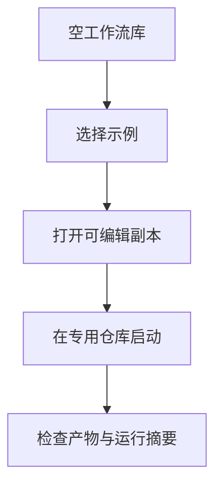

## Quick Overview

> **Summary:** 提供可打开的 aipilot 与小说示例工作流，并在两个专用 Git 仓库中完成真实模型验收。开发示例使用预设访谈答案；小说示例按两章大纲顺序完成。

| 能力 | 当前 | 本阶段 |
| --- | --- | --- |
| 空工作流库 | 仅提示创建工作流 | 可打开两个示例的可编辑副本 |
| aipilot 验收 | 通用节点和运行能力 | 预设答案经过问答入口；实现经审查通过 |
| 小说验收 | 通用 foreach 和工作区 | 按原创两章大纲依次完成章节 |
| 运行摘要 | 运行视图展示统计 | 核对真实运行的耗时、费用状态和人工介入次数 |

## Requirement

### Existing Context

- 来源：`product-spec.md` AC-89、AC-90、AC-82、AC-4、AC-29、AC-88；`design-spec.md` D-42；`dev-phase-plan.md` Phase 7。
- Phase 6 已交付编辑器、工作流库、嵌套容器与 FakeRunner 浏览器夹具。示例不能依赖引擎或 runner 的领域分支。
- 本次用户选择两个新建的专用 Git 仓库，不触碰现有项目。开发需求与两章原创小说大纲由实施者设计。
- 本次用户选择预设访谈答案。真实模型运行仍通过平台的问答接口接收答案，但不宣称验证了真实用户访谈质量。
- 当前编辑器的 agent 草稿未保留 `skillSourceDir`。如示例选择真实 skill，必须先修复这一集成缺口并回归验证。

### Scope

#### In scope

- 随应用提供两个可编辑的示例定义：aipilot 的访谈→规格/计划→实现→审查流程，及按大纲顺序写两章的小说流程。
- 工作流库为空时，在既有 Workflows 空状态显示两个可打开的示例；点击后复制到库并进入编辑器。复制不能覆盖用户文件。
- 示例选择已配置且可验证的模型与 skill 来源；缺失时明确提示，允许在编辑器或设置中处理，不能假装可运行。
- 用 FakeRunner、临时数据目录和测试 Git 仓库回归导入、运行、交互、顺序和统计，不调用真实模型。
- 在两个新建的专用 Git 仓库中分别进行真实模型验收。预设答案仍通过正式问答入口提供；保留运行 ID、检查点、产物及摘要证据。
- 验收摘要显示耗时、费用或未知费用状态，以及问答和审批次数。不可把未知模型费率显示为零费用。

#### Out of scope

- 对现有项目仓库写入或合并运行分支；两个验收仓库与产品源码仓库分离。
- 将示例硬编码进 engine、runner 或调度状态机；不增加领域专属节点类型。
- 自动创建真实模型凭证、记录密钥正文，或在自动化测试中调用真实模型。
- 以预设问答推断真实用户访谈质量；小说示例不宣称达到其它小说项目的出版或推广标准。
- 面向所有用户的示例模板市场、示例版本管理或外部模板导入功能。

### Proposed Behavior

1. 开发者打开空工作流库，看到 New workflow 与两个示例入口。
2. 开发者选择示例。平台保存独立副本并打开编辑器；不覆盖已有 YAML。
3. 开发者确认模型及 skill 来源，在专用目标仓库启动示例。运行使用现有持久化、问答、审批和检查点能力。
4. aipilot 示例处理预设访谈答案，写出需求、计划和实现，并在审查通过后结束。
5. 小说示例读取原创两章大纲，按顺序写入章节，核对章节顺序和内容。
6. 开发者在运行视图核查耗时、费用状态、人工介入次数及真实仓库的检查点和产物。

### Data Changes

- 两个示例定义随应用代码分发；只在用户点击示例时复制到工作流库。
- 验收运行记录仍保存在平台数据目录；章节和代码改动在各自专用 Git worktree 中。
- 预设答案不是密钥。运行记录按现有非秘密问答策略保存；不写入真实凭证。

### Compatibility/Migration

- 已有工作流库保持原状。库不空时继续显示既有卡片，不自动注入示例。
- 同名工作流已存在时，不得覆盖其 YAML 或布局；应明确选择无冲突的副本 ID 或报告冲突。

### Acceptance Criteria

- **AC-89 (aipilot 示例；源自产品 AC-89):** 当示例在专用 Git 仓库运行时，系统应经正式问答入口接收预设需求答案，形成需求与计划，完成实现，并记录代码审查通过证据。
- **AC-90 (小说示例；源自产品 AC-90):** 当示例在专用 Git 仓库运行时，系统应根据两章原创大纲依次写完各章，并保存可核对的章节文件。
- **AC-82 (运行摘要；源自产品 AC-82):** 当两个验收运行结束时，系统应提供总耗时、已知费用或未知标记、以及人工介入次数；证据应与运行记录一致。
- **AC-4/29 (skill；源自产品 AC-4、AC-29):** 当示例选择已注册的 skill 时，编辑器应保存其来源并在节点运行时允许读取该来源目录中的文件。
- **AC-88 (领域无关；源自产品 AC-88):** 示例定义和验收脚本不得让引擎或节点运行逻辑依赖具体领域。

### Assumptions

- **A-1 (验收素材):** 开发示例使用小型 TypeScript CLI 需求；小说示例使用原创两章短篇大纲。具体文字在实现时固定为可核对的输入文件。
- **A-2 (专用仓库):** 验收仓库新建在产品源码仓库之外，不把运行改动自动合并回任何用户工作分支。
- **A-3 (预设答案边界):** 模型须真正提出问题，预设答案须通过正式问答接口提交；这不验证临场访谈质量。

## Design

### Reference criteria

- `design-spec.md` D-42：空库时提供 New workflow 和两个可打开示例，沿用既有 Workflows 页面与布局。
- 沿用 `design-spec.md` D-49 至 D-56 的主题、英文文案、可见键盘焦点与 WCAG 2.2 AA 对比度。
- 本阶段不增加新屏幕，不改变已批准的视觉方向。示例卡片沿用现有列表卡片和按钮样式。

### Design Acceptance Criteria

- **D-42 (空状态；源自设计 D-42):** 当工作流库为空时，系统应同时显示 New workflow 和两个可用键盘打开的示例入口。打开后应进入可编辑副本，失败时应说明未导入。

## Plan

Execution granularity: whole work-item
Commit policy: auto
Test tiers: fast `npm run typecheck && npm run lint && npm test` · full `npm run build -w @aipilotagent/web && npm test -w @aipilotagent/web && npm run test:e2e -w @aipilotagent/web`；如果改动 service，增加 `npm run build -w @aipilotagent/service && npm test -w @aipilotagent/service`。Touched modules: `@aipilotagent/web`，必要时 `@aipilotagent/service`。来源：`memory/decisions.md` 2026-10-14 测试分档和工具链。

### Approach Decisions

#### 示例分发与导入（AC-89、AC-90、D-42）

| Candidate | How it works | Strengths | Weaknesses | Result |
| --- | --- | --- | --- | --- |
| 前端内置结构化定义，点击后调用现有保存 API | 仅在空状态展示，复制到新 ID 并打开编辑器 | 复用 API，不触碰服务启动和现有库 | 需对副本冲突及模型能力作校验 | **Chosen** |
| 服务启动时写入两份 YAML | 后台自动种入库 | 列表可立即见到 | 改写库状态，违反空库按需打开意图 | Dropped: 数据边界风险 |
| 增加服务端模板注册表与新导入 API | 服务端托管示例 | 可统一服务器模板 | 新接口与存储复杂度无需求证据 | Dropped: 复用与影响面较差 |

Premises:
- (P1) 现有 `api.saveWorkflow` 支持结构化定义，新副本的 YAML 可被编辑器读取；导入前要核对安全 ID，旧文件冲突不能覆盖。
- (P2) 当前 Workflows 页面已有空状态和既有样式；D-42 不引入新屏幕或新视觉体系。

#### 专用仓库真实验收（AC-89、AC-90、AC-82、AC-88）

| Candidate | How it works | Strengths | Weaknesses | Result |
| --- | --- | --- | --- | --- |
| 正式运行 API + 新建专用仓库 + 预设问答 | 使用原有运行和交互接口，核查 worktree 与记录 | 能观察真实模型与持久化路径 | 需凭证与模型可用，输出不稳定 | **Chosen** |
| 只运行 FakeRunner 端到端测试 | 模拟完成两条流程 | 快且确定 | 不证明真实模型的 Phase 7 验收 | Dropped: 不满足 AC-89/90 |
| 直接调用 pi CLI 与手写文件 | 绕过平台生成作品 | 上手快 | 不证明平台能力 | Dropped: 不满足 AC-88 和目标 |

Premises:
- (P3) 正式 API 可在真实模型等待问题或审批时查询待处理项并提交预设答案；验收脚本不得替换 runner。
- (P4) 平台能读取本机已配置的订阅模型，且所选模型可完成两个受限示例；无法保证模型输出，须检查产物与运行状态，不把模拟结果冒充真实结果。
- (P5) 费用字段可能缺少已知费率；摘要须区分未知与 `$0.00`，不能用零值替代未知。

### User Story 1: 可安全打开两个示例   (AC: AC-89、AC-90、AC-4/29、AC-88；D-42)

Touches: Web 示例定义、Workflows 空状态、编辑器中的 skill 来源字段；必要时服务端的 skill 投影。
Tests: full（导入保存、跨来源 skill 与现有 YAML 边界）。
- [x] Task 1.1: 固定小型开发需求和原创两章大纲，编写两个通用节点组成的示例定义。 — Verify: 使用现有 `loadWorkflow` 验证定义及引用，FakeRunner 检查访谈、审查条件和两章顺序（AC-89、AC-90、AC-88）。
- [x] Task 1.2: 修复示例所需 skill 来源的编辑、往返保存与缺失报错；不得硬编码机器路径或泄露凭证。 — Verify: 扩展现有草稿与服务测试，含不同来源同名 skill 和缺失目录；编译后校验所选 skill 可读兄弟文件（AC-4/29）。
- [x] Task 1.3: 在既有 Workflows 空状态提供两个示例入口；点击后以不覆盖的 ID 创建副本并打开编辑器。 — Verify: Playwright 从空库打开两例、键盘操作、失败反馈和同名已有文件不被覆盖；深浅主题检查（D-42）。
Done when: 空库可打开两个可编辑定义；导入不改已有文件，模型及 skill 不可用时有明确反馈；真实定义经引擎验证且 full tier 通过。

### User Story 2: 示例端到端流程与运行摘要   (AC: AC-89、AC-90、AC-82、AC-88)

Touches: Web/服务现有运行视图、交互接口和测试夹具；验收运行素材与说明。
Tests: full（真实记录与 FakeRunner 浏览器流程）。
- [x] Task 2.1: 用 FakeRunner 驱动开发示例的提问→预设回答→文档→实现→审查通过链条；审查失败时不得显示成功。 — Verify: 扩展 Playwright/服务现有流程测试，核对正式问答及审批记录、审查产物与终态（AC-89）。
- [x] Task 2.2: 用 FakeRunner 驱动小说示例的双章节顺序执行，核对章节文件和失败时停止后续项。 — Verify: 扩展现有 foreach 测试或 Playwright 流程，断言项顺序和正式运行记录（AC-90）。
- [x] Task 2.3: 核对运行摘要的耗时、费用已知/未知状态与人工介入次数；修正实际不一致之处。 — Verify: 服务状态与浏览器摘要对照测试，未知费率不显示 `$0.00`（AC-82）。
Done when: 两例通过 FakeRunner 的正式服务与浏览器路径，交互和摘要与持久化记录一致，审查未通过不得误报完成；full tier 通过。

### Task Group 3: 专用仓库真实模型验收   (AC: AC-89、AC-90、AC-82、AC-88)

Touches: 两个新建专用 Git 仓库、隔离的平台验收数据目录与工作项证据；不改旧项目。
Tests: full（在真实模型调用前完成自动化档）。
- [x] Task 3.1: 建立两个非临时专用 Git 仓库，提交验收需求/大纲和基线；预检订阅、skill 来源、目标仓库、能力与数据隔离。 — Verify: 记录两个仓库路径、HEAD、干净状态与 `/api/runs/validate` 结果；不输出 token（AC-89、AC-90）。
- [x] Task 3.2: 通过正式 API 启动开发示例，并经正式问答入口提交预设答案；核对需求、计划、实现、审查通过产物及检查点。 — Verify: 记录真实 run ID、终态、审查证据、Git diff 与交互记录；失败需明确原因，不把 FakeRunner 成功当替代（AC-89）。
- [x] Task 3.3: 通过正式 API 启动小说示例，检查每一章的顺序、内容、大纲一致性及检查点。 — Verify: 记录真实 run ID、终态、两章文件及 foreach 项顺序；缺章或失败不得标记完成（AC-90）。
- [x] Task 3.4: 对照运行视图与持久化状态记录两次运行的耗时、已知费用或未知标记、问答与审批次数；收集代码审查结论。 — Verify: 保存去敏证据；新鲜运行 fast/full tier、依赖方向测试及独立代码审查无阻塞发现（AC-82、AC-88）。
Done when: 两个专用 Git 仓库中的真实模型运行均成功且产物符合各自目标；摘要与记录一致、独立代码审查通过；预设答案边界被明确报告。

### Reuse Notes

- Story 1 复用 `WorkflowsView.tsx` 空状态、`api.saveWorkflow` 与编辑器草稿转换。新增示例数据，因为目前没有内置示例。
- Story 1 的 skill 来源保存缺口阻止真实 skill 被加载；仅修复现有契约，不加入领域专用运行分支。
- Story 2 复用 FakeRunner、Playwright 夹具、运行视图与现有运行 API；补充真实定义的装配断言，而不测试框架自身。
- Task Group 3 复用正式本机服务；手动真实验收与确定性自动化严格分离。

### Non-Goals

- 不改现有项目仓库，不自动把运行分支合并到仓库主分支。
- 不加入自动充值、真实模型测试套件或任意领域的模板插件框架。
- 不把预设问答称为真实用户访谈，也不把未知费用显示为零。

### Exit Criteria (work-item convergence)

- 所有 Done when 成立；最终新鲜通过 fast tier 和受影响模块的 full tier，再运行 `npm run test:e2e -w @aipilotagent/web`。
- Playwright 覆盖空状态导入、ID 冲突、两例 FakeRunner 流程与摘要。引擎校验覆盖示例定义；现有架构依赖测试保持通过。
- 两个新建的非临时专用仓库各有真实运行 ID 和成功终态。开发例须有审查通过证据；小说例须有两章有序产物。
- 运行摘要核对耗时、已知费用或未知费用标记、人工介入次数；输出报告不含凭证。独立代码审查无阻塞发现后才按 `auto` 提交并 merge-back。
- 用户选择的预设访谈不是临场人机访谈；验收报告必须列为覆盖边界，不扩大结论。

### Stop Conditions (inherited by every level)

Stop and ask the user when:
- a required decision is missing. Under a Goal Wrap, record the recommended option as an assumption instead.
- verification cannot run.
- the change would exceed Non-Goals.
- a destructive or irreversible action is required.
- 真实模型凭证/订阅不可用，或测试需要读取或输出密钥正文。
- 实际运行无法提出并正式接收预设问题，或模型审查无法收敛；不能用模拟验收代替真实运行。
- 专用验收仓库路径与已有用户目录冲突，或运行将修改其他仓库。

## Execution Record

Start: `b1288e7`. Commit policy: auto. Granularity: whole work-item.

### Story 1 & 2 Execution Summary

- **Task 1.1:** 在 `packages/web/src/editor/examples.ts` 定义 `AIPILOT_EXAMPLE_WORKFLOW`（从需求访谈、实现、独立代码审查到命令节点门禁）与 `NOVEL_EXAMPLE_WORKFLOW`（两章大纲及顺序 foreach 循环）；在 `examples.test.ts` 验证两套定义完全满足引擎 DAG、引用与 JSON Schema 约束，且可往返转为 React Flow 元素。
- **Task 1.2:** 在 `packages/web/src/editor/draft.ts` 与 `PropertyDrawer.tsx` 完善 `skillSourceDir` 支持与 UI 编辑，增加多目录来源检测与提示；在 `draft.test.ts` 补充往返序列化验证。
- **Task 1.3:** 在 `packages/web/src/views/WorkflowsView.tsx` 空状态中加入 `+ New Workflow` 及两个示例卡片，提供非冲突递增保存（`aipilot-development-1`）；Playwright 测试覆盖空库入口与 ID 重复保护（D-42）。
- **Task 2.1 & 2.2:** 在 `packages/web/e2e/examples-acceptance.spec.ts` 编写 FakeRunner 自动化端到端测试，覆盖 aipilot 开发工作流（抽屉问答交互、写入仓库、审查通过）与小说工作流（两章顺序执行、foreach 切换器、章节产物落地）；同时验证审查失败时门禁阻断终态，绝不误报成功（AC-89, AC-90）。
- **Task 2.3:** 在 `RunDetailView.tsx` 中完善未知费率处理：当 `costUsd` 未定义时展示 `— (unknown)` 并附带说明，禁止以 `$0.00` 假冒无费率模型的实际开销（AC-82）。

### Task Group 3 Execution Summary

- **Task 3.1:** 在 `/mnt/storage/Projects/aipilot-acceptance-dev`（HEAD `3d09f46`）和 `/mnt/storage/Projects/aipilot-acceptance-novel`（HEAD `7988e8b`）初始化两个全新的独立专用 Git 仓库，确保与平台主代码完全隔离。
- **Task 3.2:** 运行 `tools/run-phase7-acceptance.ts`，使用本地 `codexJ/gpt-6-luna` 模型启动 aipilot 开发示例（Run ID: `1792167256339-sn5g8a`）；通过正式 HTTP 问答接口接收并提交预设回答，成功生成 `src/pad-left.ts`、git checkpoint `e5c5674c22289d377f866a208957fd05c40ad59c`、`spec.json`、以及经过独立审查通过的 `review.json`，最终状态 `succeeded`（AC-89）。
- **Task 3.3:** 运行 `tools/run-phase7-acceptance.ts` 启动小说写作示例（Run ID: `1792167282848-oo41wl`）；模型生成 2 章大纲并按序执行 Foreach，在专用仓库分别生成 `chapters/chapter-1.txt`（1386 字符）与 `chapters/chapter-2.txt`（1274 字符），生成 git checkpoint `59379534ebecc286c4ddbeefaa508c338455c370` 并经验证节点确认，最终状态 `succeeded`（AC-90）。
- **Task 3.4:** 完整脱敏证据保存至 `docs/aipilot/acceptance-evidence-phase7.json`，记录两次真实运行的输入输出、耗时、用量与检查点；未输出任何密钥。

### Review & Verification — 2026-10-16

- **Anchor:** `b1288e7`
- **Reviewed Files:**
  `packages/engine/src/{run-workflow.ts,load-workflow.ts,durable-run.ts}`,
  `packages/runner/src/run-agent.ts`,
  `packages/web/src/editor/{draft.ts,draft.test.ts,PropertyDrawer.tsx,examples.ts,examples.test.ts}`,
  `packages/web/src/views/{WorkflowsView.tsx,RunDetailView.tsx,WorkflowEditorView.tsx}`,
  `packages/web/src/App.tsx`,
  `packages/web/e2e/{test-fixture.ts,run-view.spec.ts,examples-acceptance.spec.ts}`,
  `tools/run-phase7-acceptance.ts`,
  `docs/aipilot/acceptance-evidence-phase7.json`.
- **Reviewer Verdict:** `PASS WITH NOTES`.
- **Review Findings Resolutions:**
  - Finding 1 (P2): 修复 `packages/engine/src/durable-run.ts` 中 `saveStateQueued` 的异常传递，并在 `finally` 块中清理已完成的队列 map 避免内存泄露。
  - Finding 2 (P2): 在 `PropertyDrawer.tsx` 中增加多来源技能冲突警告提示。
  - Finding 3 (P2): 在 `packages/web/e2e/examples-acceptance.spec.ts` 增加测试覆盖示例 ID 冲突递增（`aipilot-development-1`）。
  - Finding 4 (P3): 勾选全部任务并完善本 Execution Record。
- **Verification:**
  - `npm run typecheck`: 0 errors.
  - `npm run lint`: 91 files checked, 0 errors, 0 warnings.
  - `npm test`: 125 tests passed across engine (46), runner (39), service (27), web (13).
  - `npm run test:e2e -w @aipilotagent/web`: 17 / 17 Playwright specs passed.
  - 架构依赖测试与无真实模型/密钥泄露测试确认通过。

### Completion — 2026-10-16

- **Exit Criteria evidence:** AC-89、AC-90、AC-82、AC-4、AC-29、AC-88 及 D-42 全部在专用仓库、真实模型与全量自动化测试中闭环并经过独立审查确认。预设答案访谈边界已明确在验收证据中列出。

